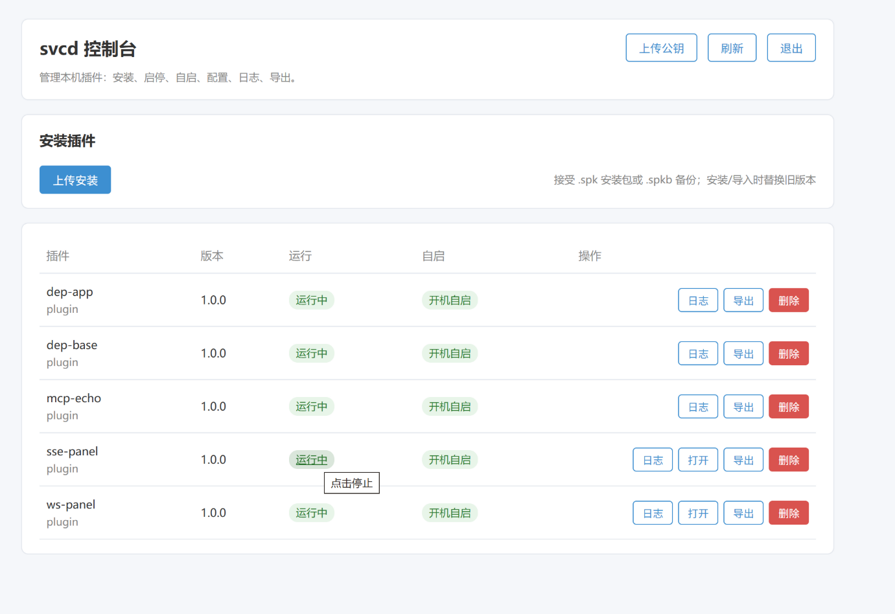
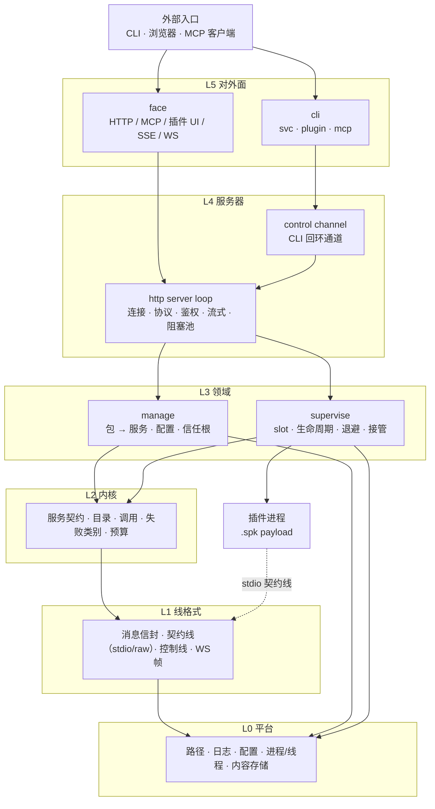

# svcd

**单机服务运行时**：把一份定义或一个签名的 `.spk` 包变成服务，让它在后台活着、能崩溃重启、能被调用，并把这些服务通过命令行、网页和 MCP 暴露出来。

- 一个二进制，四个入口：`svcd`（守护进程）· `svc`（服务管理）· `plugin`（包管理）· `mcp`（stdio 桥）
- Linux / macOS / Windows；非 root 进程自动进入 **user mode**，所有状态落在自己的目录
- 核心资产是**服务契约**：只要实现契约就是服务，载体（进程 / 内置 / 未来的复合、远程）由装配点注册
- 内存有**不变式**：`worst_case ≤ 预算`，连接数、流数、订阅数都由预算反推，不是拍脑袋的上限



控制台是 daemon 自己托管的单页（`http://127.0.0.1:8787/`），不依赖 Node，也没有外部前端构建。

## 能力

| 能力 | 做什么 | 入口 |
| --- | --- | --- |
| 监督 | 启停、崩溃重启与退避、开机自启、daemon 重启后接管、依赖先启动 | `svc start/stop/enable/disable/status` |
| 包管理 | 签名 `.spk` 的安装、校验、导出、卸载；信任根管理；包内配置与 hooks | `plugin install/verify/export/uninstall`、`svc trust` |
| 控制面 | JSON HTTP API、内嵌网页控制台、MCP（Streamable HTTP + stdio）、命令行 | `http://127.0.0.1:8787`、`/mcp`、`mcp` |
| 插件 UI | `/plugin-ui/{id}/{token}/` 托管插件的静态页面，并把 SSE / WebSocket 桥到插件进程 | 控制台「打开」按钮 |
| 静态站点 | 把一个本地目录只读地托管在 `/static/`；HTML / JS / CSS / 图片 / 图标按扩展名给 MIME，带 ETag/304 | `svcd.conf` 的 `static_root` |
| 大对象 | `$blob` 引用：大参数/结果不进帧，上传、下载、断点续传 | `POST /api/v1/blobs`、blob 下载 |
| 资源 | 内存预算（字节、百分比、自动）、CPU 预算（软闸 + 内核硬限）、workload 形状 | `svcd.conf`、`svc config tune` |

## 体积与小内存设备

目标是路由器这类小内存设备：rootfs 常见 16/32 MB，体积直接决定能不能装。

### 实测（stripped，十进制字节）

| 构建 | 目标 | 体积 |
| --- | --- | ---: |
| 全功能（默认 features） | `x86_64-unknown-linux-musl` | **2,073,568 B ≈ 2.0 MiB** |
| 全功能（默认 features） | `x86_64-pc-windows-msvc` | 1,138,176 B ≈ 1.1 MiB（基线，[ci/size-baseline.json](ci/size-baseline.json)） |
| 小内存设备 lean（如路由器，`--no-default-features`） | `x86_64-unknown-linux-musl` | **1,616,928 B ≈ 1.5 MiB** |

小内存设备（如路由器）的取舍说清楚：lean 构建没有 HTTP 面（也就没有网页控制台、插件 UI、MCP HTTP），只保留 CLI + 监督 + 契约线；要远程管理就装全功能版，2.0 MiB 对 16 MB 的 rootfs 也只占 12%。

## 快速开始

### 构建

```sh
cargo build --release

# 测试与守卫
node tools/check.mjs quick      # cargo check
node tools/check.mjs lint       # clippy
node tools/check.mjs linux      # 在 WSL 里真跑 Linux 测试
```

### 安装并启动（user mode）

```sh
svcd --install --no-service          # 装到当前用户目录，不注册系统服务
export PATH="$HOME/.local/share/svcd/bin:$PATH"   # Windows 新开终端即可

svcd start
svcd status
```

前台调试用 `svcd run --foreground`。默认只监听 `127.0.0.1:8787`；要对局域网开放，先在 `svcd.conf` 里改 `bind`，再执行 `svc lan passwd <密码>`，否则 daemon 会退回回环地址。

### 装第一个插件

`svcd --install` 会把插件商店的发布公钥写到 `<config>/trust.d/signing.pub`；装商店里的包不需要再手动 `svc trust add`。自己签的包仍然要加自己的公钥：

```sh
svc trust add my-key.pub        # 信任自己的签名公钥（一次）
plugin install demo-1.0.0.spk
svc start demo
svc list
```

> 还没有官方目录服务、审核和更新协议：今天只有发布钥这一把默认信任根，加上一个读静态发布表的初版商店（见下）。
> 要装**未签名**的 `.spk`（自己用 `plugin bundle --unsigned` 打的、或从源码构建的样例包），
> 先在本机配置里打开开关，再重启 daemon：
>
> ```ini
> # ~/.config/svcd/svcd.conf（Windows: %APPDATA%\svcd\svcd.conf）
> allow_insecure_install = true
> ```
>
> 它只影响「验签」这一步：有签名的包照常验签，未签名的包才走回退接受；结构校验（manifest、平台三元组、
> 路径、大小）不因此放松。开关关着时装未签名包会被直接拒绝（报 `signature.json must be the second entry`）。
> 没有单次安装的命令行开关，控制台也不给这个选项——开关必须留在配置里，事后可查。装完记得改回 `false`；
> 正式分发仍然应该签名；商店发布钥已经由安装器写入 `trust.d`。

然后在浏览器打开 `http://127.0.0.1:8787/`，用控制台点「打开」——控制台会现签一个 1 小时有效的插件 UI token，地址形如 `/plugin-ui/demo/<token>/`。

### 静态文件服务器

把一个目录写进 `svcd.conf`，重启 daemon，它就会以只读方式托管在 `/static/` 下：

```ini
# ~/.config/svcd/svcd.conf（路径相对 svcd.conf 所在目录）
static_root = ./public
```

```sh
# public/index.html、public/assets/app.js、public/icon.png
curl http://127.0.0.1:8787/static/
curl http://127.0.0.1:8787/static/assets/app.js
```

`/static/` 与 `/static/<目录>/` 返回该目录的 `index.html`；`/static/<目录>`（无尾斜杠）会 308 到带斜杠形式，保证相对链接能正确解析。缺失文件严格 404，不做 SPA fallback；只接受 `GET` / `HEAD`，不提供目录列表，点文件与越界路径一律 404。静态资源跟着 daemon 的认证走：默认只监听回环地址时无需登录；绑定 LAN 且设了口令时，HTML 导航会先跳登录，拿到会话后即可访问。

### 插件商店

初版商店已经开源，它就是一个普通插件：读发布表、只列本机 `platform` 能装的包，下载后经 `$blob` 与 `POST /api/v1/plugins` 交给宿主安装——签名与平台校验仍由 svcd 做。

- 商店源码：[webxxxxx/plugins · plugins/plugin-store](https://github.com/webxxxxx/plugins/tree/main/plugins/plugin-store)
- 插件列表：[docs/plugins.md](https://github.com/webxxxxx/plugins/blob/main/docs/plugins.md)——CI 生成，只列每个插件 / 平台的最新稳定版，预发布与历史版本在 [Releases](https://github.com/webxxxxx/plugins/releases)

商店自己也是插件，从 `plugin-store-v*` 的 Releases 里取本机平台的包；列表里的包同样直接装，发布钥就是 `svcd --install` 写进 `trust.d` 的那把：

```sh
plugin install plugin-store-0.1.6-x86_64-pc-windows-msvc.spk   # 版本与三元组按最新的换
svc start plugin-store             # 首装不自启
plugin install meow-1.0.1-x86_64-unknown-linux-musl.spk
svc start meow
```

装好商店在控制台点「打开」：按本机 platform 过滤、每页 50 条、已装版本低于目录版本时操作列显示「升级」。这是网页商城的第一版，不是目录服务——列表仍是一份 CI 生成的静态 Markdown。

### 接入 MCP 客户端

```yaml
transport: streamable-http
url: http://127.0.0.1:8787/mcp
headers:
  Authorization: Bearer <密码>
```

`tools/list` 里会出现每个服务的 `<id>.start`，以及插件自己声明的能力（如 `mcp-echo.echo`）。

### 资源预算

```ini
# svcd.conf
mem_budget_bytes = 536870912        # 512 MiB；或
mem_budget_percent = 90             # 可用内存的 90%
workload = interactive              # tiny / interactive / streaming
cpu_budget_percent = 90             # 软闸 + cgroup / Job Object 硬限
```

预算决定一切：`svc config tune` 打印派生结果（连接数、流数、订阅数、阻塞线程、单体上限），`svc status --resources` 看当前实际占用。

### `svcd.conf` 配置项

`svcd.conf` 的每个 live 键都在下表里。默认值写的是**派生规则**：预算是每次启动按本机算出来的，表里给的是参照预算下的期望值（tiny 128 MiB / interactive 512 MiB / streaming 2 GiB，参见 `limits/specs.rs`）；显式写的值只在允许范围内原样生效，越界会回落到本 shape 的期望值并在日志里记一条 `override:`。`svc config tune` 打印本机的派生结果，`svc status --resources` 看上次实际用的值。

改完都要重启 daemon（服务管理器重启，或 user mode 下重跑 `svcd run`）；例外是 `auth_passwd`，用 `svc lan passwd <password>` 写它并立即生效。已删除的键（`plugins_dir`、`services_dir`、`temp_dir`、`boot_scan_wait_ms`）不再有任何作用，出现在旧文档里只会得到一条告警。

#### 资源与形状

| 键 | 默认 | 干什么 | 改完怎么生效 |
| --- | --- | --- | --- |
| `mem_budget_bytes` | auto（可用内存 25%，受构建上限约束） | 本进程可规划的峰值内存。`auto` 按可用内存折扣；写数字则按原样（只被构建上限压低）。 | 重启 daemon |
| `mem_budget_percent` | 未设（与 mem_budget_bytes 二选一） | 用可用内存的百分比表达同一件事，1..100，每次启动重新解析。 | 重启 daemon |
| `workload` | 由预算派生（<512 MiB tiny，<2 GiB interactive，否则 streaming） | 预算怎么花：tiny / interactive / streaming。它决定各键的派生份额，不决定预算大小。 | 重启 daemon |
| `cpu_budget_percent` | 0（不设限） | 本进程可用的 CPU 份额，0..100；>0 时装平台硬限（cgroup cpu.max / Job Object）并在超限时拒绝新连接。 | 重启 daemon |
| `request_stack_bytes` | 128/192/256 KiB（tiny/interactive/streaming） | 每个请求线程的栈。不随预算变，只随 shape 变。 | 重启 daemon |
| `io_stack_bytes` | 64/96/128 KiB（tiny/interactive/streaming） | 每个 IO 线程的栈。 | 重启 daemon |
| `blocking_threads` | 4/8/16（tiny/interactive/streaming），2..32 | 阻塞池线程数（安装、上传、下载、API 等慢路由）。 | 重启 daemon |
| `blocking_queue` | 由连接数解算（min(max_connections,256)），1..1024 | 阻塞池可排队的作业数；满了回 503 busy + Retry-After。 | 重启 daemon |
| `max_body_bytes` | 8/64/512 MiB（tiny/interactive/streaming） | 请求体在内存里的上限；更大的完整请求体会走落盘。 | 重启 daemon |
| `max_json_body_bytes` | 64 KiB/256 KiB/1 MiB | JSON 请求体的上限，超出回 413。 | 重启 daemon |
| `max_complete_body_bytes` | 64 KiB/1 MiB/2 MiB | 每个连接常驻的请求体预算，是容量公式里的一项。 | 重启 daemon |
| `max_header_bytes` | 8/16/64 KiB | 请求头上限，超出回 431。 | 重启 daemon |
| `max_streams` | 24/48/96，1..4096 | 长连接与传输流的上限：SSE、WS、raw WS、MCP SSE、上传/下载、导入导出；一次性静态资源不计。 | 重启 daemon |
| `stream_buffer_bytes` | 8/32/128 KiB | 单个处理器的输出缓冲高水位；慢读者到点就停止输入而不是继续涨内存。 | 重启 daemon |
| `max_connections` | 由预算解算（下限 8，上限 4096） | 同时准入的连接数。显式值会被容量公式再压一次。 | 重启 daemon |
| `max_connections_per_ip` | 16/32/64 | 单个来源 IP 的连接上限。 | 重启 daemon |
| `max_subscriptions` | 64/128/256 | 整个 daemon 的订阅数上限（每个订阅只花一个游标）。 | 重启 daemon |
| `max_subscribers_per_plugin` | 16/32/64 | 单个插件的订阅者上限。 | 重启 daemon |
| `pending_queue` | 32/128/512（预算/4 MiB） | 服务器循环到监督循环之间排队的管理请求数。 | 重启 daemon |
| `progress_queue` | 16/64/256（预算/8 MiB） | reactor 到单个 MCP 流之间排队的进度事件数。 | 重启 daemon |
| `max_package_bytes` | 8/64/512 MiB | 可安装 .spk 的体积上限。 | 重启 daemon |
| `probe_available_memory` | 未设（读操作系统） | 声明可用内存，跳过 OS 读取；0 表示未知且不回退探测。 | 重启 daemon |
| `probe_cgroup_remaining` | 未设（读 cgroup v2） | 声明内存 cgroup 剩余额度，跳过 OS 读取。 | 重启 daemon |
| `probe_cpus` | 未设（读 OS） | 声明在线 CPU 数，跳过 OS 读取。 | 重启 daemon |
| `probe_install_free_disk` | 未设（读 OS） | 声明安装卷剩余空间，跳过 OS 读取。 | 重启 daemon |
| `probe_temp_free_disk` | 未设（读 OS） | 声明临时卷剩余空间，跳过 OS 读取。 | 重启 daemon |

#### 网络

| 键 | 默认 | 干什么 | 改完怎么生效 |
| --- | --- | --- | --- |
| `bind` | 127.0.0.1:8787 | HTTP 监听地址。绑定非回环地址时必须有 auth_passwd，否则回退到 127.0.0.1。 | 重启 daemon |
| `http_idle_timeout_secs` | 30/60/120 秒 | 空闲连接的超时。 | 重启 daemon |
| `transfer_timeout_secs` | 120 秒 | 单次传输（上传/下载/导入导出）的超时。 | 重启 daemon |
| `control_timeout_secs` | 30 秒，1..300 | 一条管理路由等控制通道回包的时限，超时回 504。 | 重启 daemon |
| `default_timeout` | 30000 毫秒 | 一次能力调用的默认预算（毫秒）。 | 重启 daemon |
| `max_timeout` | 300000 毫秒 | 调用预算的硬上限（毫秒），内核按它截断。 | 重启 daemon |
| `ws_max_message_bytes` | 1 MiB | 单条 WebSocket 消息的上限，超出以 1009 关闭。 | 重启 daemon |
| `ws_inflight_bytes` | 2/8/64 MiB | 所有插件未确认的 raw 字节总量。 | 重启 daemon |
| `ws_inflight_requests` | 4/16/128 | 所有插件未确认的 raw 帧数。 | 重启 daemon |
| `ws_buffer_shrink_bytes` | 64 KiB | WebSocket 缓冲区回缩阈值。 | 重启 daemon |
| `ws_raw_enabled` | on | 是否启用协议 3 的 raw 通道（/plugin-ui/{id}/{token}/raw）。 | 重启 daemon |
| `ws_raw_max_bytes` | 1 MiB | 单帧 raw 数据的上限。 | 重启 daemon |
| `ws_raw_queue` | 8/32/128 | 单个插件 stdin 上排队的 raw 帧数。 | 重启 daemon |
| `mcp_streaming` | off | 同时接受 JSON 与 SSE 的 MCP 客户端是否走流。off 时给一条 JSON（更省一个流槽与一次 reactor 跳转）。 | 重启 daemon |

#### 日志

| 键 | 默认 | 干什么 | 改完怎么生效 |
| --- | --- | --- | --- |
| `log_max_bytes` | 64 KiB，4 KiB..16 MiB | 单个日志文件的轮转阈值。 | 重启 daemon |
| `log_rotations` | 3（1..10） | 保留几个轮转文件。 | 重启 daemon |
| `log_to_file` | on | 是否写日志文件；off 时只留 stderr/syslog。 | 重启 daemon |
| `log_level` | info | 写入任何去处的最低级别：error / warn / info / debug / trace。 | 重启 daemon |
| `log` | on | 总开关：off 时既不写文件也不写 stderr。 | 重启 daemon |
| `temp_retention_secs` | 7200 秒（2 小时） | data/temp 下临时文件保留多久；0 关闭清理线程。 | 重启 daemon |
| `temp_cleanup_interval_secs` | 300 秒 | 清理线程的扫描间隔。 | 重启 daemon |

#### 生命周期

| 键 | 默认 | 干什么 | 改完怎么生效 |
| --- | --- | --- | --- |
| `rescan_interval_ms` | 5000 毫秒（0 = 不周期重扫） | 监督循环比对 services.d 指纹并收敛的周期；`svc reload` 仍可手动触发。 | 重启 daemon |

#### 安全

| 键 | 默认 | 干什么 | 改完怎么生效 |
| --- | --- | --- | --- |
| `auth_passwd` | 未设（用 `svc lan passwd` 设置） | 网页/API 的口令哈希。永远不要写明文。 | `svc lan passwd` 立即生效 |
| `allow_insecure_install` | off | 允许安装验签失败时降级接受未签名包。 | 重启 daemon |

#### 路径

| 键 | 默认 | 干什么 | 改完怎么生效 |
| --- | --- | --- | --- |
| `config_dir` | 平台默认（Linux /etc/svcd） | 输入根：svcd.conf、services.d、trust.d、compat.conf。 | 重启 daemon |
| `data_dir` | 平台默认（Linux /var/lib/svcd） | 运行状态根：plugins、temp、run。 | 重启 daemon |
| `logs_dir` | 平台默认（Linux /var/log/svcd） | 日志根：svcd.log、<id>.log、<id>-hooks.log。 | 重启 daemon |
| `static_root` | 未设（关闭） | 只读静态站点根：目录下的文件通过 `/static/` 访问；带尾部斜杠的目录取 `index.html`。 | 重启 daemon |
| `install_dir` | 未设（由 `svcd --install --prefix` 记录） | 安装前缀：初始化时补 config/data/logs 默认值，运行时不再从它推路径。 | 重启 daemon |

## 架构

### 分层



### 六层各知道什么

| 层 | 知道 | 不知道 |
| --- | --- | --- |
| L0 平台 | 文件在哪、怎么起进程、配置文本 | 「服务」这个词 |
| L1 线格式 | 字节怎么切成消息 | 消息是什么意思 |
| L2 内核 | 契约、能力、一次调用、失败类别 | 进程、socket、HTTP、文件 |
| L3 领域 | 服务怎么活、怎么管 | HTTP 头、JSON 字节 |
| L4 服务器 | 连接、握手、鉴权、流式 | 插件是什么 |
| L5 对外面 | 哪个 URL/命令对应哪个能力 | 不拥有连接、不持有资源 |

依赖只能从上往下（`dep-lint` 会拦向上的边）。完整总图、状态机和一次调用的时序见 [docs/architecture.md](docs/architecture.md)。

### 连接驱动

同一份 sans-IO 连接状态机，一个 poll seam、两个后端（[ADR-0027](docs/adr/0027-windows-runs-the-same-poll-loop.md)）：

- **Unix**：`poll(2)`；listener、连接、控制通道共用一个等待集，阻塞工作交给固定大小的阻塞池
- **Windows**：`WSAPoll`；连接状态机、stream 背压、阻塞池、deadline 与 Unix 是同一份代码，唤醒管道换成两条连通的 loopback TCP socket
- **各自的边角**：控制通道是命名管道，进不了 Windows 的等待集，仍是每连接一条 accept/读线程；MCP SSE 在 Windows 交给一条线程跑 blocking fallback，线程数受 `max_streams` 兜底

差异只剩这些边角：同样 2 GB 预算两端都派生 797 条连接，线程只跟循环、阻塞池、控制通道和 SSE 交接走。改造前 Windows 是每连接一条线程（ADR-0016），2 GB 只派生 709 条，2 GB、c50 时实测 996 条线程。

## 性能

数据来自 [docs/perf/](docs/perf/)，测试工具是 [tools/perf/budget_scenario.py](tools/perf/budget_scenario.py)（五面同时压）与 [tools/perf/ws_plugin_capacity.py](tools/perf/ws_plugin_capacity.py)（只开 WebSocket 一面），只认 100% 成功。

### 50 MB 预算能跑几个插件（容量阶梯）

| 插件数 | ops/s | p50 / p99 ms | daemon RSS | 整树 PSS |
| ---: | ---: | ---: | ---: | ---: |
| 10 | 842.5 | 1.39 / 4.3 | 5.1 MB | 8.0 MB |
| 20 | 1379.4 | 3.61 / 12.0 | 6.0 MB | 12.0 MB |
| 40 | 1425.2 | 15.37 / 36.9 | 7.4 MB | 19.4 MB |

40 个插件只把 daemon 抬到 7.4 MB。「50 MB 能跑几个」取决于算谁：daemon 自己按预算给出 405 条连接名额（2026-11-21 标定后：基线 8 MiB + 每槽 80 KiB）；整树 RSS 按每插件 3.4 MB 算，13–14 个就到 50 MB；整树 PSS 要到 ~125 个。

### 40 个插件：三档预算的 100% 成功并发

| 预算 | 每插件并发 | 总客户端 | ops/s | p50 / p99 | 再往上 |
| ---: | ---: | ---: | ---: | ---: | --- |
| 50 MB | 12 | 480 | 1305 | 207 / 756 ms | P=13（520）：113 × 503（另一轮全过，见下） |
| 512 MB | 13 | 520 | 1246 | 218 / 831 ms | P=14（560）：3 × 503，边界抖动 |
| 2 GB | ≥26 | ≥1040 | 1199 | 215 / 913 ms | 客户端封顶（in-flight ≈ 500），未压出上限 |

回落点就在派生的 `max_connections` 附近（405 / 421 / 797），503 是准入拒绝，不是超时。

用配置档（`mem_budget_percent = 90` + `tiny` + 64 KiB 单体，见下）在 50 MB 再复测一轮：P=10…16 全部 100%，in-flight 峰值 380–460——405 是**同时连接**的上限，而这套负载每次请求约 1 ms，短时越过名额不一定撞 503，越线点随突发波动（同档 P=8 的一轮出现过 3 个 503，标定前 P=13 那轮出现过 113 个）。要稳仍按 **P=12 / 480 个客户端**规划；再往上吞吐反而掉（客户端单 GIL，p99 到 1.4 s）。

### 只开 WebSocket 的插件：三档同时能跑多少个

每个插件一条常驻 WS 连接、同一时刻一个在飞请求（单并发）：

| 预算 | max_connections | 100% 成功的插件数 | 再上一个 | daemon RSS |
| ---: | ---: | ---: | --- | ---: |
| 50 MB | 405 | 405 | 406 个起 1 条 503 | 34.3 MB |
| 512 MB | 421 | 421 | 422 个起 1 条 503 | 35.8 MB |
| 2 GB | 797 | 797 | 798 个起 1 条 503 | 64.2 MB |

一条连接就是一个名额，插件数就等于派生连接数；每插件在 daemon 里约 77 KB，插件进程自己的 3.4 MB（bash）不算在预算内。

配置档（`mem_budget_percent = 90` + `workload = tiny` + `max_complete_body_bytes = 65536`）下：

| 档 | 名额 | 实测同时运行 | daemon RSS | 再往上卡什么 |
| --- | ---: | ---: | ---: | --- |
| 50 MB | 405 | **405 / 405** | 35.5 MB | 准入拒绝（64 KiB 单体在 50 MB 被上界拒绝，回落 25,600） |
| 512 MB | 3590 | **1400 / 1400** | 108.9 MB | 插件进程内存 |
| max（90% = 4.65 GB） | 4096 | **1400 / 1400** | 108.9 MB | 插件进程内存 |

512 MB 与 max 两档的名额（3590 / 4096）都远高于实测：1400 个 bash 插件已吃掉 4.7 GB 整树内存，这台 5.8 GiB 的机器上限约 1500 个——**插件数最后由插件运行时决定，不是 daemon**。50 MB 那一行的单体配置会被上界拒绝（派生报告记 `above-upper-bound`，生效值 25,600），所以与默认档一致。详见 [docs/perf/2026-11-21-ws-plugin-capacity.md](docs/perf/2026-11-21-ws-plugin-capacity.md)。

### 90% 可用内存 + interactive

| 项 | 值 |
| --- | ---: |
| 预算 | 4.7 GiB（5.2 GiB × 90%） |
| max_connections / max_streams | 431 / 431 |
| 单体上限 / 流缓冲 | 9.0 MiB / 287 KiB |

把 880 条 SSE/WS 一直开着做准入探测：**接纳 431 条（216 SSE + 215 WS），其余 449 条 503**，正好等于派生值。同样预算下默认形状（streaming）是 800 条连接、单体 4.7 MiB——**形状买的是单体大小，不是并发**。

### 平台差异：两端已经同价

同一预算、同一形状下，Windows 与 WSL 派生出同一组名额——连接是 wait set 条目而不是线程：

| 预算 | 形状 | WSL（poll） | Win11（WSAPoll） |
| ---: | --- | ---: | ---: |
| 50 MB | tiny | 405 | 405 |
| 512 MB | interactive | 421 | 421 |
| 2 GB | streaming | 797 | 797 |
| 4.67 GiB | interactive | 431 | 431 |

2026-11-22 起两端跑同一个 poll loop（[ADR-0027](docs/adr/0027-windows-runs-the-same-poll-loop.md)）：`stack_per_connection` 已删，`threads()` 只剩循环线程 + 阻塞池，Windows 不再因为「每连接一条线程」（128 KiB 栈/条）少拿名额。改造前那一列是 64 / 340 / 709 / 421，50 MB 差 6.3 倍。上表四个数是在 Windows 本机用 `svc config tune` 现跑的（0.1.5 的二进制）；WSL 一列是 2026-11-21 标定时的值——两端本来就是同一份派生。

吞吐上 Windows 反而更高（512 MB、c10：777 vs 329 ops/s，Windows 用 Python 插件、WSL 用 bash 插件），这是改造前的数据，「176 线程 / 8.9 核」也属于旧的线程模型；两端同 loop 之后的吞吐还没有重测。

> 口径提醒：压测客户端是 Python 线程（一个 GIL），高并发点的 p50/p99 含客户端排队；daemon 自己单次服务时间在 1.4 ms p50，1.4k ops/s 时只用 0.55 个核。

## 协议一致性矩阵

没有依赖三方库，协议栈也是（没有 hyper / tokio / tungstenite），每条线都要和标准逐项对。下表来自
[#106 的协议一致性审计](https://github.com/webxxxxx/plugin-manager/issues/106#issuecomment-7055759922)（2026-11-21），
图例：✅ 线格式测试通过（raw socket / 独立客户端）；🟡 已实现，但只有仓内测试或实现偏宽松；❌ 未实现或不符合规范；— 明确不在范围。
带 † 的行是审计之后 main 有变化、已按当前代码校正的。

| 面 | 项 | 状态 | 证据 / 说明 |
| --- | --- | --- | --- |
| HTTP | 请求行与 header 解析 | 🟡 | 自写 `parse`（`model.rs:454`）宽松：无冒号行被忽略、字段名不校验、版本可缺省、多空格接受 |
| HTTP | keep-alive（1.1 默认 / 1.0 显式） | ✅ | `wants_keep_alive_parts`；`tests/http/protocol.rs::http_keep_alive_serves_two_requests_on_one_connection` |
| HTTP | HEAD 无 body | ✅ | `tests/http/protocol.rs` 四条 `head_*` |
| HTTP | chunked 请求体 | ✅ | `chunked_bodies_work_for_management_json_routes`、`blob_upload_accepts_chunked_and_multipart_bodies` |
| HTTP | `Expect: 100-continue` | ✅ | `a_buffered_route_sends_100_continue_before_reading_its_body` |
| HTTP | 重复 / 冲突 Content-Length、TE+CL | ✅ | `model.rs::framing` 单测：相同值接受，冲突与 TE+CL 拒绝 |
| HTTP | 413 | ✅ | `oversized_upload_is_rejected_before_the_body` |
| HTTP | 414 | ❌ | 没有单独 URI 上限；长 URI 落在 header 上限里 |
| HTTP | 431 † | ✅ | 审计时回 400；现在拒绝路径回 431 + `headers_too_large`，`--compat` 有「800 B 通过 / 128 KiB 回 431」两条向量 |
| HTTP | Range / If-Range / ETag / 304 / 412 / 416 | ✅ | `tests/http/transfer.rs::blob_download_supports_range_etag_and_conditionals` |
| HTTP | 多段 Range | 🟡 | 按整段 200 返回（`docs/plugin-blob.md` 明说，不生成 multipart/byteranges） |
| HTTP | pipelining | ❌ | 注释明确「写完响应再读下一个」；不作承诺 |
| HTTP | HTTP/1.0 | 🟡 | 代码有分支，无专门用例 |
| HTTP | HTTP/2 / TLS | — | 没有；h2spec 不引入 |
| WS | 握手（Upgrade / Connection / 13 / Key / Accept） | ✅ | `src/wire/ws/accept.rs` 单测 + `plugin_ui_websocket_*` |
| WS | 文本 JSON-RPC / 二进制 raw | ✅ | `plugin_ui_websocket_bridges_calls_notifications_and_control_frames`、`plugin_ui_raw_round_trips_binary_frames` |
| WS | 分片 / 控制帧 / close code | ✅ | 1003 / 1009 / 1013 单测；`plugin_ui_raw_reports_protocol_errors_with_a_close_frame` |
| WS | Origin 403 | ✅ | `plugin_streams::same_origin` + `tests/http/ui.rs` |
| WS | 子协议 / 压缩 | — | 不协商（客户端拿不到扩展，不违反） |
| WS | Autobahn † | 🟡 | 审计时未接；现在 `/plugin-ui/.../ws` 的二进制子集 63 OK / 19 FAILED（全是文本用例）/ 3 INFORMATIONAL，文本全量待 #250 |
| SSE | `event` / `id` / `data` + chunked | ✅ | `src/wire/sse.rs`、`plugin_ui_sse_streams_plugin_notifications` |
| SSE | Last-Event-ID 回放 | ✅ | `plugin_ui_sse_replays_after_last_event_id`；ring 256 条 / 2 MiB，溢出发 `event: reset` |
| SSE | 心跳注释 | ✅ | `: ping` 每 15 s |
| SSE | retry | 🟡 | 不发（可选字段） |
| SSE | 多行 data | 🟡 | 只输出单个 `data:` 行；当前 payload 是压缩 JSON 不会换行，但编码器不拆分 |
| SSE | 无 id 事件不推进 last id | — | 每条事件都有 `seq` id，服务端没有这个分支 |
| MCP | modern 2026-07-28：discover / list / call | ✅ | `tests/mcp.rs::http_mcp_discover*`、`http_mcp_caps_the_request_body_at_one_mib` |
| MCP | 头/体镜像校验、版本 | ✅ | `http_mcp_validates_mirrored_headers_and_versions` |
| MCP | 401 / 403 / -32602 | ✅ | `http_mcp_requires_a_bearer_and_ignores_cookies`、`--compat` 三条 |
| MCP | progress + SSE 流式回复 | ✅ | `tools_call_forwards_plugin_progress`、`server/mcp/progress.rs` |
| MCP | 官方 SDK stdio | ✅ | `--compat` 实跑 PASS（legacy 桥） |
| MCP | 官方 SDK Streamable HTTP † | ✅ | 审计时记 ❌（SDK era 不匹配）；现用 DSH 同款 `@modelcontextprotocol/client` 2.2.0 实测协商到 `2026-07-28`、列出 14 个工具 |
| MCP | 多版本协商 | 🟡 | 只实现 2026-07-28 |

审计表里 🟡「请求行与 header 解析」的 MUST 级细节——header 名与冒号间的空白、obs-fold、缺失/重复/非法 Host、请求行多余 token、414——逐条依据见
[#251 的调研](docs/research/2026-11-21-http-request-line-and-strict-parsing.md)，实现排期在 #251。

审计表不覆盖自研的三条线（没有外部标准可比）：

| 线路 | 形状 | 约束 |
| --- | --- | --- |
| 控制线 | unix socket / 命名管道上的 JSON 行 | 方法集固定：`svcd.ping` / `svcd.compat` / `svcd.reload` / `registry.*` / `svc.list` / `tools.*` |
| 契约线 | 子进程 stdio 上的 NDJSON JSON-RPC 子集 | 没有握手、没有批处理；单帧上限 1 MiB |
| 原始通道 | 二进制 WebSocket，帧内 `u32 len + u32 stream_id + payload` | 只给自家插件；订阅队列与在途预算都有上限 |

## 路线图

架构文档把系统对服务的四件事定为 manage / supervise / orchestrate / cluster；今天**只有前两件是跑通的**（[docs/architecture.md §3](docs/architecture.md#L83-L92)）。下面这些是方向，不是承诺。

| 方向 | 状态 | 要做成什么 | 现在的地基 |
| --- | --- | --- | --- |
| **服务编排** orchestrate | 方向，无票 | 多个服务组合：并行 / 串行 / 汇合 / 定时；组合体本身又是一个服务，能被目录、能力面、监督当成普通服务看待 | L3 目录已留位；「复合服务不需要新机制、递归免费」写进了架构 §4，v1 边界见 [ADR-0014](docs/adr/0014-composite-service-v1-boundary.md)；还没有编排语法与执行器 |
| **集群** cluster | 方向，无票 | 决定服务在哪台机器上跑；对编排透明——编排只认契约，不知道背后是本机还是远程 | 契约的 `ImplRef` 只差一个远程 adapter；远程节点的注册、健康、调度、跨机调用都还没有 |
| **AI agent** | 方向，无票 | 两层：① 运维 agent——查状态、启停、读日志、定位失败、按预算调整；② 按需求生成插件——产出 manifest + payload，签好名再走安装 | ① 的地基已经在了：`/mcp`（modern Streamable HTTP）已暴露 `tools/list`、`tools/call` 和每个服务的 `<id>.start`，接一个 agent 就能用；② 的地基是 `plugin verify` + `plugin install` 的校验链 |
| **插件 GUI** | 部分有票 [#41](https://github.com/webxxxxx/plugin-manager/issues/41) | 插件自带的状态面板、配置表单、能力调用界面；桌面侧用 WebView 窗口承载 | web 侧已实现：`.spk` 里的 `ui: {type: web, entry}` 由 daemon 托管在 `/plugin-ui/{id}/{token}/`，SSE / WebSocket / rpc 都通，浏览器侧 toolkit 在 [plugins/sdk/web](https://github.com/webxxxxx/plugins)；桌面 `svc ui` 只定了入口，内容还没定（#41） |
| **插件商城** | 网页侧初版已开源（[plugin-store](https://github.com/webxxxxx/plugins/tree/main/plugins/plugin-store)），无票 | 按 `platform` 三元组过滤、签名分发、更新与审核；桌面/网页都能逛 | 分发地基齐了：`.spk` 签名 + `svc trust` 信任根 + `plugin verify` / `export` / `bundle` + 全三元组平台校验；初版商店已跑通「列表 → 下载 → 安装」，还缺远端目录服务、审核与更新协议 |
| **OpenWrt ipk → spk** | 方向，无票 | 把 OpenWrt 的 opkg/apk 包转成 `.spk`：`depends` → `dependencies`、init 脚本 → `lifecycle`、架构 → `platform` 三元组，让现有插件生态能直接装 | `.spk` 就是 ustar tar + manifest，`plugin verify` 已能独立做结构校验；小内存设备发行（路由器；svcd 自己打成 ipk/apk、targets.toml、overlay 约束）在 [#43](https://github.com/webxxxxx/plugin-manager/issues/43)，与这个转换器是两件事 |

这些方向都**不在核心层规格里**（[core-selection-spec.md](docs/core-selection-spec.md#L5) 明确把商城、ipk2spk、AI 建插件流水线列为 out of scope），所以上面没有给时间表；要动哪个，先拆票。

## 插件模板与共建

想写插件，从模板仓库开始：[webxxxxx/plugins](https://github.com/webxxxxx/plugins)。

- **四种语言模板**：Rust / C / POSIX sh / PowerShell，每种都带一个协议壳 SDK（协议循环、并发、取消、MCP 返回形状、文件收发），作者只写核心逻辑；
- **浏览器侧 toolkit**：`sdk/web/` 是 ESM、无构建步骤，提供 invoke / SSE / WS / 上传下载，直接配合 `/plugin-ui/{id}/{token}/` 用；
- **一个工具链**：`plugin-tools`（单个 Rust 二进制，不需要 Node / Python）管 `template` / `build` / `dev` / `devkey` / `sync` / `check`，打包仍调宿主的 `plugin bundle`；
- **四份样例**：`samples/hello-{rust,c,shell,powershell}` 是同一套「五能力 + 配置 + 通知 + UI」的四种写法；
- **给 AI 的手册**：`skills/` 描述插件开发的语言、toolkit 与边界；
- **自带 CI**：每个插件带上自己的 `build.yml`，平台列表从 `.plugin.json` 读，构建后跑 `plugin verify` 再上传 `.spk`。

两条命令起步：

```sh
cd tools/cli && cargo build --release        # 一次性；产物 plugin-tools 放进 PATH
plugin-tools template wireguard              # 选语言（1-4）与平台（1-7）
cd plugins/wireguard && plugin-tools build   # 构建 + 打包；不带 --key 就是未签名包
```

`plugin-tools check <file.spk>` 走的就是 `plugin verify`。模板是唯一真源，样例由模板生成，别手改；`samples/hello-rust` 是手写参考实现。

欢迎提 issue / PR 共建模板、SDK 与样例——四门语言的坑和各平台的差异，一个人补不完。

## 文档

| 文档 | 内容 |
| --- | --- |
| [docs/architecture.md](docs/architecture.md) | 分层总图、监督状态机、契约与一次调用的路径 |
| [docs/testing.md](docs/testing.md) | 测试分层与 WSL 真跑方式 |
| [docs/user-mode.md](docs/user-mode.md) | 用户模式安装、目录、安全边界 |
| [docs/perf/](docs/perf/) | 全部性能矩阵与复现命令 |
| [webxxxxx/plugins](https://github.com/webxxxxx/plugins) | 插件模板、四语言 SDK、`plugin-tools`、四份样例 |
| [plugins/plugin-store](https://github.com/webxxxxx/plugins/tree/main/plugins/plugin-store) | 初版插件商店：读发布表、平台过滤、下载后交给宿主安装 |
| [docs/plugins.md](https://github.com/webxxxxx/plugins/blob/main/docs/plugins.md) | 插件下载列表，CI 生成，只列每平台最新稳定版 |
| [samples/spk-tests/](samples/spk-tests/README.md) | 五个 WSL 冒烟包：依赖、MCP、WS、SSE |

## 测试

```sh
node tools/check.mjs quick           # 编译门
node tools/check.mjs lint            # clippy -D warnings
node tools/check.mjs linux           # WSL 内 cargo test 全量
python3 tools/spk_smoke.py --binary target/debug/svcd   # 安装真实 .spk 并跑五组检查
```

## License

[LICENSE](LICENSE)
