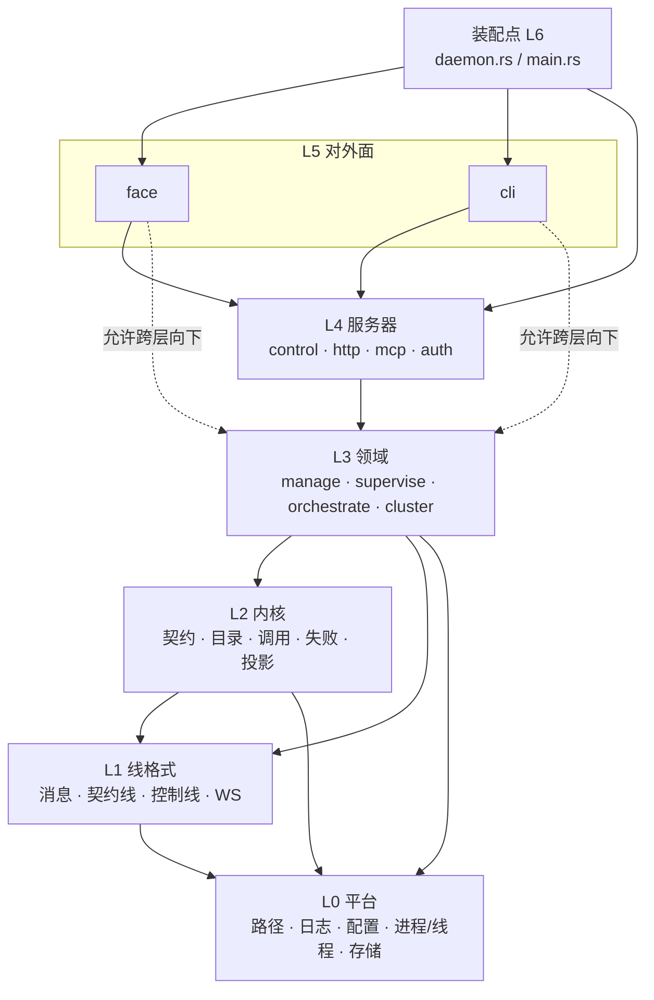
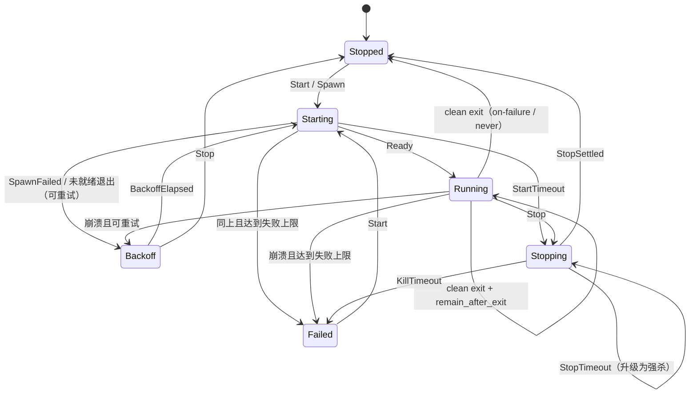
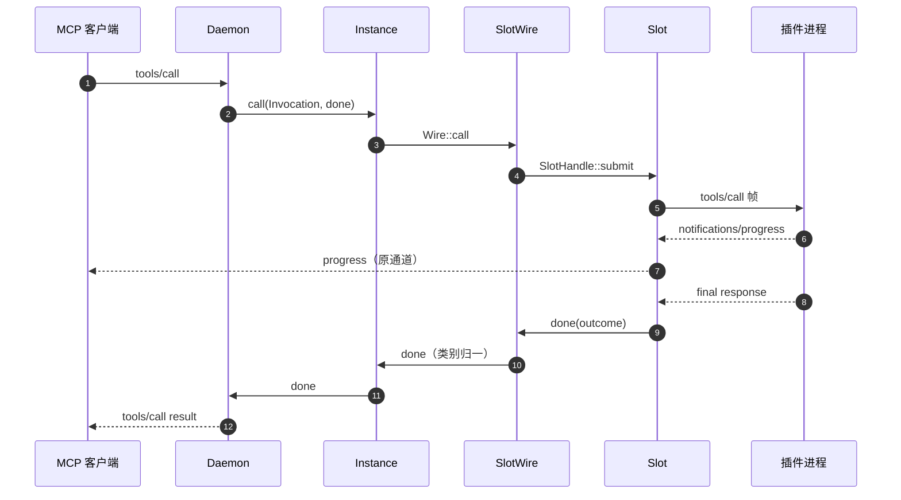
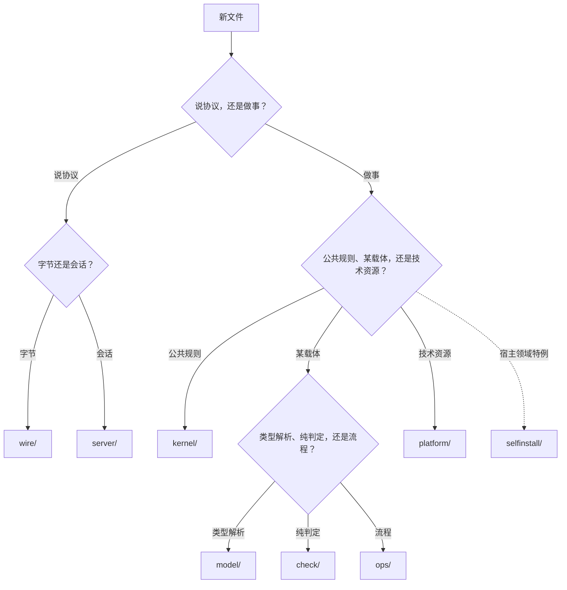
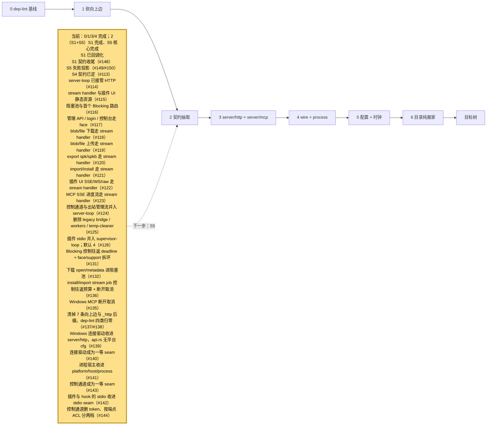

# svcd 架构总图

> 状态：v1.0（2026-11-16）。命名已定，见第 15 节与 ADR-0011 / ADR-0012。
> 这份文档是全组唯一的「总图」：加模块、加协议、判断一处改动该落在哪一层，先看它。
> 词表见 [GLOSSARY.md](../GLOSSARY.md)；已定决策见 [docs/adr/](adr/)；测试分层见 [testing.md](testing.md)。

## 0. 一句话

svcd 是一个**服务的运行时**：把定义或 `.spk` 变成服务，让服务在本机活着，把多个服务组合成新服务，并能决定它们在多台机器上怎么摆放。

「服务」是唯一的名词（`kind` 有 core 与 plugin 两种），其余都是动词。

## 1. 两个轴

**横向**是系统对服务做的四件事；**纵向**是代码的六个层。

| 层 | 管理 manage | 监督 supervise | 编排 orchestrate | 集群 cluster |
|---|---|---|---|---|
| 装配点 | `daemon.rs` / `main.rs`：把下面所有层装起来，不含业务 | | | |
| **L5 对外面** | 命令 | 状态查询 | 流的定义 | 节点列表 |
| **L4 服务器** | `control`（命令行通道）· `http` · `mcp` · 准入——**一行共用** | | | |
| **L3 领域** | `manage` | `supervise` | `orchestrate` | `cluster` |
| **L2 内核** | 契约 · 目录 · 调用 · 失败 · 投影——**一行共用** | | | |
| **L1 线格式** | 消息信封 · 契约线（stdio/raw）· 控制线 · WS 帧——**一行共用** | | | |
| **L0 平台** | 路径 · 日志 · 配置 · 进程/线程 · 设备兼容 · 内容存储——**一行共用** | | | |

三个直接推论：

1. **只有 L3 被切成四块**，其余行整行共用。所以顶层目录约 11 个，不是 4×6 个——共用的东西只该有一份。
2. **越往下越稳定**：路径解析十年不变，编排语法一定会改。所以依赖只能从上往下。
3. **L4 只有一行**：命令行、网页、MCP 都从这一层进。加一种协议只动 L4 和 L5。

### 1.1 依赖方向



图里只画**允许的依赖方向**，实际边是它的子集；任何向上的边都是 `dep-lint` 违规。跨层向下（虚线）允许，不要求逐层经过。

## 2. 六层：知道什么，不知道什么

| 层 | 知道 | **不知道**（更重要） |
|---|---|---|
| L0 平台 | 文件在哪、怎么起进程、配置文本长什么样 | 「服务」这个词 |
| L1 线格式 | 字节怎么切成一条消息、消息怎么写成字节 | 这条消息是什么意思 |
| L2 内核 | 服务契约、能力、一次调用、失败类别、预算 | 进程、socket、HTTP、文件 |
| L3 领域 | 怎么把定义变成服务、怎么让它活着、怎么组合、怎么摆放 | HTTP 头，JSON 字节 |
| L4 服务器 | 连接、协议握手、鉴权、流式 | 插件是什么 |
| L5 对外面 | 哪个 URL 或哪条命令对应哪个能力 | 不拥有连接、不持有资源 |

**依赖**：A 调用 B 就叫「A 依赖 B」，箭头指向 B。单向 = 只能 A→B。

**为什么必须单向**：今天 `api.rs` 同时是 L4 的引擎、L5 的端点、L1 的帧机，3719 行；改一个协议要动三层。如果 L3 也去读 HTTP 头，将来加 gRPC 就要再改一次业务。

## 3. 四个动词

| 动词 | 做什么 | 今天 |
|---|---|---|
| **管理** manage | `.spk` 或定义 → 服务；改配置、卸载 | 有 |
| **监督** supervise | 让服务在本机活着：启停、崩溃重启、daemon 重启后接管 | **有（唯一跑通的）** |
| **编排** orchestrate | 多个服务组合：并行/串行/汇合/定时；组合体本身又是一个服务 | 无 |
| **集群** cluster | 决定服务在哪台机器上运行 | 无 |

`storage` 不是动词，也不是一个领域：它是这四件事共用的**调用基础设施**——大参数不进帧、只传引用（`$blob`），真正的字节存在平台层的内容存储里。见第 5、6 节。

### 3.1 监督状态机



`Failed` 不是终点：显式 `Start` 仍可重新进入 `Starting`。daemon 重启后的接管直接把状态恢复到 `Running`，不是上面任何一条事件边。

## 4. 契约：全系统唯一的连接点

**服务契约** = 一个服务对外承诺的东西：能力面、调用信封、生命周期义务、健康语义、它可能给出的失败类别。

只要实现契约，就是服务。于是：

| 实现方式 | 谁负责 | 状态 |
|---|---|---|
| 本机进程（stdio） | `supervise` | 有 |
| 内置（svcd 自己的 core 服务） | `supervise` | 有 |
| 复合流（一条编排） | `orchestrate` | 无 |
| 远程节点 | `cluster` | 无 |

由此得到三条免费的性质：

- **复合服务不需要新机制**：它只是「用编排实现的服务」，在目录、能力面、监督眼里和普通服务一样。
- **递归免费**：复合服务里可以再放复合服务。
- **远程对编排透明**：编排只认契约，不知道背后是本机还是远程。

### 4.1 接口形状（ADR-0013）

契约是一个**值**（`Contract`）+ **两个入口**（`call` 完成回调、`lifecycle(Ensure|Quiesce|Probe)`），实现由 `ImplRef{tag}` 交给装配点注册的 adapter——所以新增运行载体只加一个 adapter，不改内核。能力面显式声明并带 `effect` / `idempotent`；失败是 `{class, retry: Now|Never|After(t), detail}`，`detail` 不可被上层解析；死亡与超时按**判定时刻的客观状态**归类。

完整决定见 [ADR-0013](adr/0013-service-contract-interface.md)；复合服务的 v1 边界（root 定义、0 或 1 个能力、单机执行、加载期校验）见 [ADR-0014](adr/0014-composite-service-v1-boundary.md)。

槽是所有 `exec` 服务的默认载体：`exec` 存在即由监督槽唯一拥有，调用点在每次能力调用（builtin 与 `<id>.start` 工具除外）构造 `SlotWire`。`ImplRef` 只用于槽之外的载体（内置 `svc`；未来的复合/远程）；因此没有 `tag=process` —— process 不是第二种载体，只是槽里的一个进程。互斥由注册表边界强制（`Service::carrier` + `Registry::insert` / `replace`），一致性断言按入口划分：`SlotWire` 过调用面，生命周期用委托断言。见 [ADR-0015](adr/0015-exec-services-default-to-slot.md)。

### 4.2 一次 `tools/call` 的路径



daemon 只递交调用，不等待；slot 事件循环在完成/超时时调用 `done`，所以慢插件占 pending 表而不是线程。progress 走原客户端通道，最终结果走 `done`。

## 5. 目录

```
src/
  main.rs                     多入口分派（argv[0]）
  daemon.rs                   装配点：装配所有模块 + 事件循环 + 关停

  kernel/                     L2 内核（四动词共用，只有定义与判定）
    mod.rs
    contract.rs                 服务契约：能力面、调用信封（含 $blob 引用）、生命周期义务、健康
    registry.rs                 注册表：定义、能力索引、依赖与环检测
    invoke.rs                   一次调用：超时、重试、取消、预算
    failure.rs                  失败类别 + 可重试性 + 汇合聚合
    projection.rs               能力面 → 各对外面的唯一投影源

  manage/                     L3 领域·管理
    mod.rs                      唯一对外接口
    model/  manifest.rs  ustar.rs  layout.rs  hooks.rs
    check/  verify.rs  trust.rs  compat.rs  interpreter.rs
    ops/    install.rs  uninstall.rs  import.rs  export.rs  bundle.rs  scan.rs

  supervise/                  L3 领域·监督
    mod.rs
    model/  entry.rs  machine.rs  record.rs  definition.rs
    check/  restart.rs  backoff.rs  oneshot.rs  reconcile.rs
    ops/    slot.rs  adopt.rs  rescan.rs  hook.rs  script.rs

  orchestrate/                L3 领域·编排（第一个文件出现时才创建）
    model/  step.rs  flow.rs  trigger.rs  fanin.rs
    check/  dag.rs  mapping.rs  budget.rs
    ops/    executor.rs  trigger.rs  composite.rs

  cluster/                    L3 领域·集群（同上）
    model/  node.rs  placement.rs
    check/  eligibility.rs
    ops/    remote.rs  heartbeat.rs  failover.rs

  wire/                       L1 线格式：字节 ↔ 消息
    mod.rs
    message/  rpc.rs  envelope.rs        共享消息信封
    contract/ stdio.rs  raw.rs           daemon ↔ 插件实例
    control/  channel.rs  client.rs      daemon ↔ 命令行
    ws/       frame.rs  accept.rs

  server/                     L4 服务器：协议会话
    mod.rs
    control/  listener.rs  client.rs  handle.rs   命令行通道与出站管理流也是服务器（#124）
    http/     contract.rs  dispatch.rs  engine.rs  server.rs  stream.rs  driver.rs  pool.rs  budget.rs  wire.rs
    mcp/      session.rs  transport.rs  progress.rs
    auth/     gate.rs  token.rs  session.rs

  face/                       L5 对外面：端点与投影
    mod.rs
    api.rs           /api/v1
    plugin_ui.rs     /plugin-ui 静态资源与实时路由的入口（#115/#122）
    plugin_streams/  /plugin-ui SSE · WS · raw 的 sans-IO handler（#122）
    mcp_tools.rs     能力面 → tools/list · tools/call
    blob.rs  blob_upload.rs  install.rs  export.rs

  cli/                        L5 对外面：命令行
    mod.rs  svc.rs  plugin.rs  status.rs

  platform/                   L0 平台：宿主资源与 OS 能力
    mod.rs
    paths.rs  log.rs  config.rs  compat.rs
    host/  proc.rs  threads.rs  wake.rs  zerocopy.rs
    storage/  meta.rs  path.rs  upload.rs  part.rs  gc.rs    内容寻址存储（原 blob）

  selfinstall/                特例：宿主领域（注册服务、PATH、卸载器）
    mod.rs  plan.rs  execute.rs  service_win.rs
```

`orchestrate/` 与 `cluster/` 现在不建：**目录在第一个文件出现时创建**，不建空壳。

`platform/storage` 是内容寻址存储（原 `blob.rs`）：上传会话、分片、过期回收。它和 `log` 的文件轮转同类——都是技术资源，所以归平台，不归领域。领域侧只需要契约能表达「这个大参数是 `$blob` 引用」。

## 6. 四种模块种类

| 种类 | 模块 | 内部形态 | 允许依赖 |
|---|---|---|---|
| 领域 | manage · supervise · orchestrate · cluster | `model/` → `check/` → `ops/` | kernel、wire、platform |
| 编解码 | wire | `message/` · `contract/` · `control/` · `ws/` | platform |
| 适配 | server · face · cli | 不分层，保持薄 | 全部领域 + wire + kernel |
| 内核 / 平台 | kernel · platform | 平铺，只有定义与判定 | platform（kernel）／无（platform） |

领域模块内部三段，顺序不能反：

- `model/` 类型、解析、不变量 —— 最稳定，先写
- `check/` 纯函数：校验、策略、上限 —— 不碰资源，最好测
- `ops/` 真正干活：起进程、写文件、发请求 —— 最薄，最容易变

三个特例，别硬套：

- **内核**只有定义与判定（契约、目录、失败类别、预算），不许出现进程、socket、文件。
- **平台**可以持有技术资源及其回收（日志轮转、临时文件、内容存储），但**不许出现服务、能力、调用这类领域概念**。
- **`selfinstall`** 是宿主领域（注册服务、改 PATH、卸载器），内部只有 plan（算要做什么）→ execute（做），并且把「需要重启 daemon」作为**结果返回**，不许反调装配点。

## 7. 依赖规则（四条不变量）

1. **只能从上往下。** 层由目录种类决定，不允许反向。
2. **同层领域模块之间只许「查」与「共享定义」，不许「替对方做」。** 监督可以读目录里有没有这个服务，不能替 manage 执行安装。
3. **L4 不认识 L3 的领域概念；L5 不拥有连接。**
4. **`platform` 可以持有技术资源及其回收，但不许出现领域概念；`kernel` 不许出现进程、socket、文件。**

今天的三处真实反例（用来验证规则不是空话）：

- `slot`（L3 监督）调用 `mcp::tool_error`（L5 的错误格式）——领域调对外面。
- `transfer`（本应是 manage 的一次导入动作）反向依赖 `package` / `plugin` / `status` / `channel`。
- `install`（自身安装）直接调 `daemon::shutdown_quiet`——下层调装配点。

## 8. seam 地图

**seam** = 一个可以整体换掉实现、调用方不用改的位置；判断标准是**今天有几个真实实现**（一个 = 想象中的 seam）。

| # | seam | 两侧 | 今天几个 adapter | 状态 |
|---|---|---|---|---|
| **S1** | **服务契约** | 内核 ↔ 四种运行实现 | 1 个显式 adapter（内置）+ 槽（exec）→ 未来 4 | **已完成**（ADR-0013/0015；#102/#103/#104 交付 Contract/Wire/conformance/Launchers；#148 把 `Contract` 收进 `registry::Service`，删掉 runtime Capability DTO） |
| S2 | 调用传输 | 内核 ↔ 载体 | 1（本机 stdio） | 暂不开，但信封必须先定 |
| S3 | 线格式实现 | 线格式 ↔ 平台 | 2（unix poll / windows 线程） | **已完成**（#139 把 Windows 连接驱动收进 `server/http/{threads,fallback}.rs`、端点经 `hooks` 反注入，`api.rs` 无平台 cfg；#140 起 `trait ConnectionDriver` + `poll` / `threaded` 两个实现，`entry.rs` 只剩一行平台别名） |
| S4 | 请求交接 | 服务器 ↔ 对外面 | 6+（两种结果：内存响应 / sans-IO stream handler） | **接口已定**（ADR-0016；#113 契约）；**server-loop 已接管 Unix listener / 连接 / pending 表（#114）**；**stream handler 事件/动作面与插件 UI 静态资源已接入（#115）**，`server/http/driver.rs` 管 deadline/文件发送/`max_streams`，静态资源走 `SendFile` 且不占 `max_streams`；**阻塞池已接线（#116）**：固定 `blocking_threads`（默认 2，clamp 2..8），队列有界 64，每连接最多一个任务，满队列/重复任务 503 + `Retry-After`，首个 `Blocking` 路由是 `/api/v1/services`；**剩余管理 JSON / login / 控制台已走 face（#117）**，除 version/console 外共用 2 条阻塞 worker（饱和时 503 + `Retry-After`），public route 跳过 transport auth，CSRF 与 plugin-token 留在 face；**blob/file 下载已走 stream handler（#118）**：Range/条件请求线路不变，多分片按 `SendFile` 续传，下载占共享 `max_streams` 预算且 Unix 不再有下载 takeover 线程；**blob/file 上传已走 stream handler（#119）**：simple/chunked/multipart/可恢复分片与 `Expect: 100-continue` 线路不变，body 经 `SubmitBlocking` 进阻塞池，排队/运行期间暂停读取（背压），断开清理 staging；上传占共享 `max_streams`，Unix 不再有上传 takeover 线程；**export spk/spkb 已走 stream handler（#120）**：布局留在 `package::TarPlan` / `plugin::plan_export_spkb`，`face/export.rs` 的 `ExportStream` 只把「小字节段 + 服务端文件发送」的计划投影成响应，产出与旧实现逐字节相同的 tar（backup/plugin.spk/config/trailer），拿到 `max_streams` 槽之后才构建 plan，headers 与文件名不变，导出不再有 takeover 线程、不写临时归档；**MCP SSE 进度流已走 stream handler（#123）**：`POST /mcp` 的 header/bearer 校验不变，进度事件先于最终结果，`McpSseStream` 占共享 `max_streams`（满时 503 + `Retry-After`，不启动插件调用），旧 `ConnState::McpSse` 与独立 64/429 计数已删除；**控制通道与出站管理流已并入 server-loop（#124）**：CLI 连接、outbound streaming client 与 HTTP/流共用一个 poll 集，`server::control` 拥有 listener/连接/进度 socket，`PendingCall` 队列有界 256（满时该连接 -32000 并关闭），两条 reactor 线程删除，默认空载 12→10；shutdown 由 daemon 停 loop 后排空 control 回包；插件 UI 的 SSE / WS / raw 已走 stream handler（#122）；**import/install 已走 stream handler（#121）**：`face/install.rs` 认领 `POST /api/v1/plugins` 与 `POST /api/v1/import`，body 经阻塞池喂给 `package::StagingInstaller`（sans-IO tar），签名/trust/compat/sha256 与 staging 校验不变，`.spkb` 外层 tar 与裸 config 分流，断开/失败清理 staging，上传占共享 `max_streams`，Unix 不再有 import/install takeover 线程；**#125 删除 legacy bridge / 4 条 HTTP worker 与独立 temp-cleaner 线程**：face 之外的剩余路由走共享阻塞池，temp 清理归 supervisor 定时器；**#126 把插件 stdio reactor 并入 supervisor-loop**：`reactor.rs` 只是被动 poll set，由 supervisor loop 的 `poll_once` 驱动，独立 `svcd-reactor` 线程删除，插件 stdout/stderr、exec-ready 日志与协议 3 raw 线路不变；默认空载 4 条（supervisor、server loop、2 条阻塞 worker）；**#131 给 Blocking 控制往返加 `control_timeout_secs` deadline（超时 504；断开取消按轮询周期生效），并把 face→api helper 下沉到 `face/support.rs`（`api` 记为 compose）**；**#132 把下载的 locate/metadata/touch/open/manifest 读移进阻塞池**：首个 `Writable` 提交 job，304/404/412/416 在 job 内渲染、头先于 body，队列满时 GET/HEAD 回 503 `busy` + `Retry-After`（HEAD 无 body），分片 open 与 export 的 loop 读保持现状；**#133 把 route + transport auth 前移到读 body 之前**：face 每请求只 route 一次，body limit 由 `Route.body` 的 `BodyPolicy` 唯一决定，`server/http/mod.rs` 的 path 限流表删除，401/413 不读未声明的 body（带 body 的早拒 `Connection: close`，bodyless 401 保持 keep-alive），Buffered 路由按需回 `100 Continue`，Windows 回退同步；**#136 把同一预算扩到 install/import 的 stream job**（`JobBudget` + `transfer_timeout`，Linux `POLLRDHUP` 发现暂停连接的 FIN）；**#135 让 Windows 的 MCP SSE 在客户端断开时取消控制读、丢弃迟到回包并释放 `max_streams` 与连接线程（Unix 路径不变）** |
| S5 | 失败投影 | 领域 ↔ 对外面 | 3（HTTP / CLI / MCP） | **已完成**（#149/#150 控制通道 `Problem`/`data` 与 HTTP 投影；#151 把 face-local 的安装/导入/配置/trust/blob 错误改成 typed，`package/plugin/trust/transfer/blob/interpreter/hook/bundle` 在抛出处给类别，face 只按类型投影（管理失败一张 `Problem → HTTP` 表，存储/请求体/阻塞池各自带窄类别），不再按 message 猜状态） |
| S6 | 进程与管道 | 监督/线格式 ↔ 平台 | 2（unix / windows） | **已完成**：**#141 把进程宿主收进 `platform/host/process`**（unix 进程组 / Windows Job，服务与 hook 的组、父死保护都在 `configure` 里）；**#142 起管道也是一个真 seam：`stdio`（`Plan` / `Target`）按 `Ready`/`protocol` 开匿名管道、把读端交给 poll set 或读线程**，宿主差异只在 `stdio/platform/{unix,windows}.rs`（`O_CLOEXEC`/`O_NONBLOCK` 与 `CreatePipe`/句柄继承），`slot.rs` / `hook.rs` 的 stdio 段无平台 cfg；**#143 把控制通道收进 `ControlChannel` seam**：`channel/platform/{unix,windows}.rs`，`channel.rs` 无平台 cfg，`daemon.rs` 只剩一条 `bind_server`；**#144 删掉 `svcd.token`，控制通道按端点 ACL 分两档**：Unix `svcd.sock` 0660 / `svcd-admin.sock` 0600，Windows 两条管道各自显式 protected DACL（当前用户或 `svcd` 组），`install-service` 建组，客户端按方法选端点、未知方法 fail closed 到 admin |
| S7 | 配置来源 | 所有模块 ↔ 配置 | 1 生产 + 测试 | **设计已定**（[ADR-0019](adr/0019-config-is-derived-once-at-the-composition-root.md)：运行配置 `Config{settings, settings_path, paths, limits}` 在组合根派生一次，传值不传 trait；`Paths::{resolve, under}` 两个构造入口；env 只在 bootstrap 读；`log` 保持进程级 sink、`S8` 单开）。**S7a 已完成（#157）**：`Config`/`Paths` 在组合根派生一次，四批把 95 处目录调用迁到构造参数，contract 删掉全部目录自由函数与 5 个测试后门（模块级测试不再起 daemon）；`SVCD_*` 只在 `Config::bootstrap` 与唯一的容忍入口 `config::ambient_paths`（stop / install / SCM readiness）读；**S7b 已完成（#158）**：`settings` 与 `limits` 的两个进程级缓存（`settings::{SETTINGS,CONFIG_PATH}`、`limits::LIMITS`）和 `current()` 入口删除，`settings::load` 一次解析文档与路径、`limits::derive` 保持纯投影，所有读取点改从 `Config`（或收窄的 `&Limits` / `&Settings`）来；daemon 全程只解析一次：`ensure_conf` 生成或选中的文件供 service unit 与下次启动，本次运行沿用 bootstrap 得到的文档 |
| S8 | 时钟 | 监督/编排 ↔ 时间 | 1 生产 + 测试 | 未开 |
| S9 | 准入 | 服务器 ↔ 认证 | 4（token / bearer / cookie / 本机免认证） | 未开，四分支挤在 `lan` |

开 seam 的顺序：**S1（含 S5 失败类别）→ S4 → S3 → S6 → S7/S8**；**S1 / S3 / S4 / S5 / S6 已完成，下一步是 S7（配置来源）**。S9 随时可做，S2 等集群真正开始再开。

S4 的最终线程预算（#126 合并插件 stdio 反应器后：两条循环 + 两条阻塞线程，默认 4 条）是 **Unix 的默认拓扑**。迁移期：legacy HTTP worker（4 条）和 takeover 仍在时默认 12 条；#124 把控制 listener 与出站客户端并入 server-loop、删掉两条 reactor 后为 10 条；**#125 删除 legacy bridge、4 条 worker 与独立 temp-cleaner 线程后为 5 条（supervisor、server loop、插件 stdio reactor、2 条阻塞 worker）；#126 把插件 reactor 并入 supervisor loop 后为 4 条（supervisor——同时 poll 插件 stdio、server loop、2 条阻塞 worker）**。Windows 本轮保留每连接一条线程的回退，`max_connections` 是它的线程上限；Windows 不承诺 4 条线程，IOCP 留给 S3/S6。该回退仍执行 `max_connections` / `max_connections_per_ip` / `http_idle_timeout_secs`。**#140 之后这条线固定为：Unix 空载 4 条；Windows 每连接一条线程、`max_connections` 是线程上限，不承诺 4 条（IOCP 留给后续）。**

## 9. 新文件放哪：三个问题

```
1. 它在「说协议」还是在「做事」？
   说协议 → server/（会话）或 wire/（字节）
   做事   → 问 2

2. 它是「四种运行载体的公共规则」还是「某一种载体的做法」？
   公共规则   → kernel/
   某一种载体 → manage/ supervise/ orchestrate/ cluster/
   技术资源   → platform/（例如内容存储、日志文件）

3. 在动词目录里，它是类型解析、纯判定，还是流程？
   类型解析 → model/   纯判定 → check/   流程 → ops/
```



对外面额外一条：**`face/` 与 `cli/` 只做「URL 或命令 → 能力」的翻译，不写流程**；有流程就回第 2 问。

## 10. 扩展剧本

| 要加的东西 | 改哪里 | 不需要动 |
|---|---|---|
| 一个 HTTP 端点 | `face/xxx.rs` + `server/http/routes` 一行 | 引擎、领域、其他面 |
| 一个流式端点 | 同上，返回 sans-IO stream handler（连接仍归 server） | 引擎（今天要改两个引擎） |
| 一种新协议（gRPC / MQTT / WS 控制面） | 新建 `server/xxx/` + `face/xxx_*.rs` | supervision、manage、编排、集群 |
| 一种汇合策略 | `orchestrate/model` + `check` | 执行器、契约、监督 |
| 一种触发器 | `orchestrate/ops` + `server` 一个入口 | 流模型、复合 |
| 一种运行载体（WASM / 容器） | 新模块实现契约 | 管理、编排、集群、对外面 |

## 11. 今天的文件怎么进这棵树

| 今天 | 将来 | 拆点 |
|---|---|---|
| `package.rs` `bundle.rs` `trust.rs` `interpreter.rs` | `manage/` | 按 model / check / ops 三段拆 |
| `plugin.rs` | `manage/`（布局与扫描）+ `kernel/contract.rs`（能力声明） | 声明与操作分开 |
| `slot.rs` `supervisor.rs` `registry.rs` `runtime.rs` `hook.rs` `script.rs` `definition.rs` | `supervise/` + `kernel/registry.rs` | 注册表类型进内核，运行载体留监督 |
| `blob.rs` | `platform/storage/`（内容寻址、上传会话、回收） | `$blob` 引用语义归 `kernel/contract` |
| `ipc.rs` `rpc.rs` `rawhub.rs` `reactor.rs` | `wire/contract/` + `wire/message/` | 帧、消息、连接分开 |
| `channel.rs` | `wire/control/` + `server/control/` | 字节在线格式与客户端轮次在 wire；控制会话已在 `server/control/`（#124） |
| `api.rs` | **四块**：`server/http/` + `face/api.rs` + `wire/ws/` + `kernel/failure.rs` | 它今天横跨三层 |
| `mcp.rs` `mcp_http.rs` `catalog.rs` | `server/mcp/` + `face/mcp_tools.rs` | 传输契约与能力投影分开 |
| `blob_http.rs` `ui_http.rs` `webui.rs` | `face/` 下同名词，去掉 `_http` | 只留投影（export 已在 #120 落到 `face/export.rs`，install 已在 #121 落到 `face/install.rs`，`install_http.rs` 已删除） |
| `svc.rs` `plugin_cli.rs` `status.rs` | `cli/` | — |
| `install.rs` `service_win.rs` | `selfinstall/` | plan / execute |
| `paths.rs` `log.rs` `settings.rs` `limits.rs` `proc.rs` `threads.rs` `wake.rs` `zerocopy.rs` `compat.rs` `auth.rs` | `platform/` | 技术底座 |
| `main.rs` `daemon.rs` | 原地 | 装配点 |

## 12. 迁移顺序

| 步 | 动作 | 验收 | 状态 |
|---|---|---|---|
| 0 | `tools/dep-lint` 只观察，先报出当前所有违规 | 得到基线红线清单 | 完成（基线） |
| 1 | 砍向上边：`is_privileged`→platform、`target()`→platform、`MAX_SCHEMA`/`MAX_PROTOCOL`→kernel、`Restart`/`Status`→kernel、`definition→registry` 归位 | lint 少 6 条红线，测试全绿 | 完成（#137/#138） |
| 2 | 契约从 `slot`/`package`/`registry` 抽出（S1 + S5 失败类别，形状见 ADR-0013） | 编排可以用 fake 契约开始写 | **S1 完成（#148）；S5 完成（#149/#150/#151）** |
| 3 | 抽 `server/http` + `server/mcp` + 请求交接（S4） | `api.rs` 降到 1500 行以下 | 完成（#112–#136） |
| 4 | 线格式与进程（S3 / S6） | Windows 支持变成「加一个 adapter」 | 完成（#139–#144） |
| 5 | 配置与时钟（S7 / S8） | 模块级测试不再起 daemon | **S7 完成（#157/#158）**：`Config`/`Paths` 注入 + contract，`Settings`/`Limits` 收口、无进程级缓存；S8 未开 |
| 6 | 目录按本文件重排（纯搬家） | 编译与测试全绿 | 未做 |

当前：0 / 1 / 3 / 4 完成；2（S1+S5）已完成；5 进行中（S7 完成；S8 未开）；6 未做。



## 13. 不做什么

- **不切多个 crate**：36k 行、单二进制、交叉编译目标多；目录 + lint 已经给到九成收益。
- **不做通用 HTTP 框架**：`server/http` 只认两种结果（内存响应、sans-IO stream handler）、三个动作（接连接、派发、交出 handler）。
- **不给每个模块硬套三层**：`wake`(48 行)、`rpc`(88)、`paths`(252) 就是单文件。
- **不引入事件总线或 DI 容器**：配置用显式参数；一个实现的 seam 不开。
- **不动 ADR 已定的语义**：接管、oneshot、重启前清理、未签名安装、token 校验时机。

## 14. 既有 ADR 落在哪

| ADR | 落点 |
|---|---|
| 0001 单一 multicall 守护进程 | 装配点 `daemon.rs` / `main.rs` |
| 0002 生命周期与解释器 | `manage/model`（声明）+ `manage/check`（解释器解析） |
| 0003 密码与配置目录 | `platform/config` + `server/auth` |
| 0004 只读根文件系统上的 install_dir | `selfinstall/plan` + `platform/paths` |
| 0005–0007 接管 / 一次性服务 / 重启前清理 | `supervise/model` + `supervise/check` + `supervise/ops` |
| 0008 设备兼容标识 | `platform/compat` |
| 0009 未签名安装 | `manage/check` |
| 0010 bind 与插件 UI token | `server/auth` |

## 15. 已定的命名与决策

命名（2026-11-16 定）：

1. 四个动词：**管理 / 监督 / 编排 / 集群**（manage / supervise / orchestrate / cluster）。
2. 内核层：**kernel**；技术底座：**platform**。
3. 内容存储不是独立领域，归 `platform/storage`；`$blob` 引用语义归 `kernel/contract`。

两条 ADR：

- [ADR-0011](adr/0011-service-contract-is-the-only-composition-point.md) **服务契约是唯一组合点**：管理生产契约实例，监督 / 编排 / 集群是实现契约的三种运行载体，复合与远程靠「实现同一契约」获得，不靠特判。
- [ADR-0012](adr/0012-protocol-is-server-plus-face.md) **协议 = 服务器 + 对外面**：服务器做会话，对外面做端点投影；新增协议不改现有代码。
- [ADR-0019](adr/0019-config-is-derived-once-at-the-composition-root.md) **配置在组合根派生一次**：运行配置 `Config` 是只读值，构造器注入、函数收窄参数；env 只在 bootstrap 读。

下一步（按风险排序）：

1. **S8 时钟**：与 S7 同期但独立成票；S7（#157/#158）已经收口，注入形状固定。
2. **目录按本文件重排**：§12 的 step 6，纯搬家，等时钟收口后做。

已完成：**S5 失败投影**（#149/#150 控制通道 `Problem`/`data` 与 HTTP 投影；#151 face-local typed errors——S5 的 HTTP 字符串匹配归零，全仓没有按 message 选状态的代码）。
