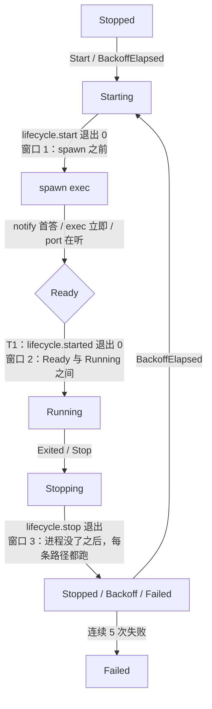

# 守护进程类插件的生命周期缺口：spawn 之后没有钩子，插件也无法请求重跑

- 日期：2026-11-27
- 状态：**已决策（2026-11-27）**——按 T1 / T2 / T3 三张实现票拆
- 触发案例：`plugins` 仓库的 meow 插件（路由器网关），常驻 3 个进程，其中 2 个是为了补契约的空洞而写的看护 shell
- 适用范围：`exec` 是被监督进程的插件（`kind = plugin`）；core 服务同样受益，但本文按插件写

## 决定

1. **T1：`lifecycle.started`**——spawn（且 `exec.ready` 满足）之后跑一次、必须退出、失败即本次启动失败；每次重启都重跑。等价 systemd 的 `ExecStartPost`。
   同一票里加**停止原因**（`SVCD_STOP_REASON` / `SVCD_LAST_EXIT`），让已有的 `lifecycle.stop` 能按“为什么结束”分支——它替代了 `on_crash` / `on_backoff` / `on_stopping` 三个候选回调。
2. **T2：`POST /api/v1/services/{id}/restart`**——插件页面改完配置点一下就能重跑，等价 `svc restart`。**不是** `/plugin-ui/{id}/{token}/restart`（原因见 T2）。
3. **T3：`exec.ready: "port"`**——宿主等端口真的在听才算 Ready，让“就绪”有准确含义，也省掉 T1 里的轮询。**blocked by T1，可延后**。
4. **不做**：
   - 每个状态一个回调（判定见「为什么只有三个窗口」）；
   - `detach` / PIDFile（systemd `Type=forking`，见否决一节）；
   - capability 走 HTTP 代理（A+B 不够用再说）；
   - daemon 重启接管后补跑 `started`、drop-in 脚本服务的 `started`、pre-stop 钩子（见「已知缺口」）。
5. meow 的 `meow.sh` 拆成三个短命动作是 **`plugins` 仓库的票**，本文只交付宿主能力、契约、测试和文档。

## 为什么只有三个窗口（而不是每个状态一个回调）

状态机里能被“等”的窗口只有三个，加上 T1 补的这个，共四个：



判据：**只有同时满足 (1) 存在一个“应该等”的窗口，且 (2) 失败有定义好的后果时，才配一个钩子。** 按这条筛 7 个候选：

| 候选 | 有窗口可等吗 | 失败改变什么 | 结论 |
| --- | --- | --- | --- |
| `on_starting` | 有 | 启动失败 | 就是今天的 `start` |
| `on_ready` | 有 | 启动失败 | T1 的 `started` |
| `on_running` | 与 `started` 同一个点 | 无新语义 | 不做 |
| `on_crash` / `on_exit` | 有，就是 `stop`（且总在下一次 spawn 之前跑） | 进程已死，改不了什么 | 给 `stop` 喂原因（T1） |
| `on_backoff` | 没有（等它等于推迟重启） | 只能记日志 | 不做 |
| `on_failed`（放弃） | 终态，没有窗口 | 只能记日志 | 等真有需求再加单点 |
| `on_stopping`（杀之前） | 没有（`SIGTERM` 就是这个） | 不能拒绝停止 | 不做，见「已知缺口」 |

“观察状态”不是钩子的职责：`svc status` 的投影（`state` / `failures` / `last_exit` / `health`）、日志和插件页 SSE 已经覆盖。条件、顺序、跨服务联动属于 Flow 的范畴（`GLOSSARY.md:263-275`，目前只有词条没有实现），不要塞进 `lifecycle`。

## 背景：现在的生命周期契约

| 动作 | 何时跑 | 依据 |
| --- | --- | --- |
| `lifecycle.start` | 每次 spawn `exec` **之前**，必须退出；非零或超时 = 本次启动失败、`exec` 不 spawn | `docs/core-selection-spec.md:90`、`ADR 0002:47` |
| `exec` | 唯一的被监督进程，独立进程组（`src/platform/host/process.rs:332`） | 同上 |
| — | **（空）** | **G1，T1 补** |
| `lifecycle.stop` | 被监督进程消失**之后**跑一次；主动停、崩溃不重启、崩溃重启前、启动失败**每条路径**都跑 | `docs/core-selection-spec.md:90`、`ADR 0002:62` |
| `lifecycle.status` | `svc status` 按需探测 | 同上 |

就绪语义（`docs/core-selection-spec.md:32-34`）：

- `exec.ready: notify`（**默认**）：宿主往 stdin 发首个协议请求，**首个合法响应 = Ready**。这同时意味着这个服务是**通道对端**（`src/supervise/check/peer.rs:11`）。
- `exec.ready: exec`：spawn 成功即 Ready，不建 JSON 通道，**不是**通道对端（`src/supervise/check/peer.rs:29` 的测试就叫 `fire_and_forget_services_own_no_channel`）。
- 通道对端在启动窗口内退出 = `ChannelLost`，`svc start` 报失败（`src/supervise/check/start.rs:16`、`ADR 0006` 的补记 #183）。
- T3 之后会有第三个值 `port`：loopback connect 成功才是 Ready，像 `exec` 一样不建通道。

进程与重启：

- 组内任一进程存活即 `Running`，leader 退出不触发重启，退出码存着等组空了再结算（`src/supervise/ops/slot.rs:581`）。
- `svc stop` / 重启按进程组终止；`tree_alive` = `kill(-pgid, 0)` + 扫 `/proc`（`src/platform/host/process.rs:391-451`）。
- 重启策略由宿主给（默认 `on-failure`，`GLOSSARY.md:243`），manifest 里没有这个字段。

## 触发案例：meow 为什么是 3 个进程

`plugins/meow/platforms/meow.sh`（在 `plugins` 仓库）的结构就是被 G1/G2 逼出来的：

- 看护 shell（`supervise()`，`:968`）：起 meow 子进程、等 `:7893` 监听、**装 nat 规则**、崩溃时降级成 `off`、规则跟着进程一起撤。
- 通道子 shell（`:1138`）：答 `mode` 能力（读/切代理类型），因为页面要用 `ui.invoke('mode')`。
- meow 本体：被 `-d/-f/--ext-ui` 拉起的那个。

代价：多 2 个进程；宿主已有的能力（等就绪、崩溃重启、进程组终止、stop 收尾）在脚本里被重新实现了一遍；页面上的 `mode` 与守护进程的真实状态之间还需要手工同步。

**同类插件的通行做法是另一条路**：`plugins/sshd`、`plugins/hysteria` 的 `start` 直接 `exec` 真进程（`sshd.sh:114` 是 `exec "$DATA/dropbear" -F …`，`hysteria.sh:140` 是 `exec "$HERE/mini-sb-agent" -config …`；两个文件的开头注释都写着“宿主监督的就是这个脚本，所以 start 直接 exec 内核”），进程数 1，收尾靠 `lifecycle.stop`。它们不需要等端口，也不需要从页面切配置——所以没暴露这个缺口。

## 三个缺口

### G1：spawn 之后没有钩子

`start` 在 spawn 之前、`stop` 在进程消失之后，中间是空的。凡是“必须等进程真的开始服务才能做”的动作都没有位置：

- 装网络副作用：iptables/nft 的 PREROUTING、`ip rule`、路由、DNS 劫持；
- 反向：撤这些副作用必须**先撤规则、再停进程**，否则 LAN 打到死端口——今天这条做不干净（`stop` 跑在进程没之后），见「已知缺口」的 pre-stop。

于是只能：

| 绕过 | 做法 | 代价 |
| --- | --- | --- |
| 看护进程 | 一个 shell 常驻，起子进程、轮询端口、装规则、收尸 | 多 1~2 个常驻进程；重实现宿主的就绪/重启/降级；`svc status` 的 pid 是看护而不是本体 |
| 规则先挂 | 在 `lifecycle.start` 里就 `fw up`，spawn 之后规则才有效 | spawn 到监听之间 LAN 打到无人监听的端口（立即 RST，不是黑洞，但确实是断流） |
| leader 先退 | 脚本 spawn 完本体、装好规则后自己退出，靠 `slot.rs:581` 的“组内还有进程就保持 Running” | **服务标识错位**：`svc status` 的 pid 是已退出的 leader；退出码是脚本“故意退”的码，不能表达本体怎么死的；重启决策依赖一个已经不在的进程的码 |

### G2：插件无法请求“重跑一遍”

页面上改一个会影响进程启动形态的配置（比如要不要开 tproxy 监听、要不要接管 LAN），改完必须**重启进程**才生效。但插件侧今天能用的只有：

- `tools/call` → 绑在常驻通道上，而“要保留通道”正是“必须有个常驻 shell”的原因（鸡生蛋）；
- 改写配置后让进程自己退出 → 只有 `exit 非零` 才会被 `on-failure` 重新拉起，而“我是故意退出的”和“我崩了”共用同一个通道；`exit 0` 则不重启。

结果就是 meow 现在这样：通道子 shell 杀掉本体、看护 shell 看到 rc 再按新形态重起——一个微型状态机，只为了“重启自己”。T2 解决它。

### G3：没有准确的“就绪”语义（次要）

`ready: exec` 等于 spawn 即就绪；`ready: notify` 的就绪是“能答 RPC”，不等于“端口在听”。所以 `svc start` 返回成功时，服务可能还需要几百毫秒到几秒才能真正接流量；依赖它上线的其他服务/规则也因此没有可靠的挂点。T3 解决它，排在 T1 之后。

## T1：`lifecycle.started`（窗口 2）+ 停止原因

### 契约

```json
"lifecycle": {
  "start":   { "path": "payload/bin/meow.sh", "args": ["prepare"] },
  "started": { "path": "payload/bin/meow.sh", "args": ["started"] },
  "stop":    { "path": "payload/bin/meow.sh", "args": ["stop"] }
}
```

`started` 与 `start` / `stop` 同形：`path`（必须绝对，且在 `files[]` 里）、`args`、`env`、`timeout`（秒，默认 15，上限 300）。

### 语义

- **时机**：该次 spawn 达到 Ready 之后（`notify` = 首个合法响应；`exec` = spawn 成功；T3 之后 `port` = 端口在听），在**对外报 `Running` 之前**跑。
- **必须退出**；非零或超时 = 本次启动失败：停整组、跑 `stop` 钩子、进入正常失败路径（退避重试，连续 5 次进 `Failed`）。理由：网关只挂半套规则比不起更糟。
- **每次 spawn 成功后都跑**：崩溃重启、`svc restart`、`svc start` 都重跑。**接管不跑**（见已知缺口）。
- **幂等**是硬要求（崩溃重试会重跑），写进文档与 `plugin check` 的提示。
- **状态时序**：`started` 跑到一半时对外仍是 `starting`，`svc start` 还没返回；依赖它的服务不会继续 start。
- **`started` 期间进程自己退出** = 本次启动失败（不会把死进程报成 Running，也不会进 `ChannelLost` 的更晚分支）。
- **环境**：沿用现有钩子环境。核心服务拿 `SVCD_SERVICE_ID` / `SVCD_ACTION=started` / `SVCD_DATA_DIR` / `SVCD_CONFIG_DIR` / `SVCD_LOG_DIR`；插件包只拿 `SVCD_PLUGIN_DIR` / `SVCD_LOG_DIR` / `SVCD_TEMP_DIR`，**动作靠 `args` 传**（`SVCD_ACTION` 是核心服务专属，`src/supervise/ops/slot/commands.rs:87` 会把它从插件子进程里删掉）。
- **权限**：以插件自己的权限跑（就是安装者权限），不经过 shell 也不提升。
- **校验**：`remain_after_exit` 的一次性服务不得声明 `started`（进程可能当场就退，与门控语义冲突）；drop-in 脚本服务不支持 `started`（`src/kernel/script.rs:28` 只有 `start|stop|status`）。

### 停止原因环境变量（同一票）

有了 `started`，“起来时做什么”齐了；“死的时候做什么”还缺原因。`stop` 钩子在每条路径上都跑，但不知道自己为什么跑。给**停止动作**加两个变量：

| 变量 | 取值 |
| --- | --- |
| `SVCD_STOP_REASON` | `stop`（显式 stop / restart 的停止半程）、`shutdown`（daemon 整体退出）、`crash`（进程非正常结束，含启动期崩溃）、`exit`（进程正常结束且不重启）、`start-failed`（start 钩子 / started 钩子 / spawn 失败，进程可能从未产生） |
| `SVCD_LAST_EXIT` | 退出码，或 `none`（未产生退出码：信号、被强杀、进程从未存在；只有 `crash` / `exit` 时才是退出码） |

原因由**触发事件**决定，不靠推断状态：`Event::Exited`（Running/Starting）→ `crash` 或 `exit`；`Event::SpawnFailed` / `Event::StartTimeout` → `start-failed`；`request_stop` → `stop`；`stop_all` → `shutdown`。核心服务与插件拿同一套值（插件侧只有 `stop` 动作拿，exec 进程不拿）。

这样 meow 的看护 shell 只要一个 `case "$SVCD_STOP_REASON"`：`crash|start-failed` 时把 config 降级成 `off`，其余保持；规则无论如何由 `stop` 撤。

### 实现落点（原提案写的三处要改）

1. **门控挂在 `Slot::apply`（`src/supervise/ops/slot.rs:350`），不是 `lifecycle.rs:148`。** 那个等待循环只服务 `svc start/restart`；崩溃与退避重启走 `BackoffElapsed → Action::Spawn → begin_start`，根本不经过它。
2. **复用生命周期动作的既有机器**：`ActionRun`（`slot/action.rs`）+ `hook_command`（`slot/commands.rs:23`）+ `<id>-hooks.log`，模板就是 `slot/prelude.rs`。**不是** `ops/hook.rs` 的 `Runner`（那是安装钩子 postInstall/preRemove）。
3. **失败路径不新造**：复用 `Event::StartTimeout` 那条（`fail_after_stop` + 停组 + `stop` 钩子 + 退避）。新增的只是 `Slot::start_failure`，让 `svc start` 快速返回原因；否则 `src/supervise/check/start.rs` 把 `Backoff` 判成 `Waiting`，用户要等满 30 秒才看到一句 `start timed out`。
4. **预算**：`start_deadline`（`src/supervise/ops/lifecycle.rs:305`）= 30s + `start_action_budget`（`:483`），现在只算 `start` 的 `max`。started 跑在 Ready 之后，必须把它也算进去，否则「ready 20s + started 15s」会被自己的等待循环判超时。

具体改动：

| 文件 | 改动 |
| --- | --- |
| `src/kernel/registry.rs:149` | `Lifecycle` 加 `started`；`HOOK_STARTED_TIMEOUT_MS`（默认 15_000，上限沿用 `HOOK_TIMEOUT_MAX_MS`）；顺手修掉 `Lifecycle` 那段「`start` 取代 `exec`」的过期注释 |
| `src/supervise/model/definition.rs:255` | drop-in 脚本构造 `Lifecycle` 处：`started: None` |
| `src/supervise/model/definition.rs:503` | core JSON 解析：读 `started` |
| `src/manage/model/manifest.rs:100` | manifest `Lifecycle` 加 `started` |
| `src/manage/check/verify/manifest.rs:234` | `check_lifecycle` 的表加 `started`（files[] 归属 + 超时 + 参数校验）；「declares no start, stop or status」文案更新 |
| `src/manage/ops/scan.rs:160` | `convert_lifecycle_hook` 调一次 `started` |
| `src/manage/ops/install.rs:454` | executables 列表加 `started`（脚本钩子要过同一套解释器校验） |
| `src/supervise/ops/slot.rs` | 字段 `started: Option<ActionRun>` / `started_owed: bool` / `ready_pending: Option<u32>` / `start_failure: Option<String>`；`Action::Spawn` 置 `started_owed` 并 abort 上一代；`apply` 拦截 `Event::Ready`（`started_owed` 且 pid 对得上 → 不消费事件，先跑钩子）；`pump` 加 `check_started`；`apply` 入口在 `started.is_some()` 时先 abort（结算路径自己先清空字段，所以这条规则自动覆盖 Stop / Exited / SpawnFailed / StartTimeout） |
| `src/supervise/ops/slot/prelude.rs:123` | `ready: exec` 的 `machine.step(Event::Ready)` 改成走 `apply`，否则门控只接一半 |
| `src/supervise/ops/lifecycle.rs:148` | `start_layer` 循环里先 `take_start_failure()` → 立刻 `Err(Internal, 原因)`；`:483` 的 `start_action_budget` 加上 started 的 `max` |
| `src/supervise/ops/slot/stop.rs:108`、`slot.rs:350` | `ensure_stop_action(now, reason)` 收原因；`hook_command` 之后追加两个环境变量；`request_stop(now, reason)` 区分 `stop` / `shutdown`；`Machine` 记 `cause`，由 `Exited` / `SpawnFailed` / `StartTimeout` 分支设置 |

### 测试

- 单测（`src/supervise/ops/slot/tests.rs`）：声明 started 时 Ready 不落 Running；钩子退出 0 → Running + Publish；钩子非零 → 组被停、stop 钩子跑过、进 Backoff、`start_failure` 带原因；钩子超时；钩子期间进程自己退出 → 失败；无 started 的定义**行为逐字节不变**（回归）。
- 集成（`tests/plugin.rs`，`agent.sh` / `agent.cmd` 双份）：`svc start` 后 `started` 跑过且发生在 Running 之前；`svc restart` 与崩溃重启都重跑；失败包 → 启动失败且没有残留标记文件；`stop` 钩子拿到 `SVCD_STOP_REASON` / `SVCD_LAST_EXIT` 的四种取值（含 `shutdown`）。
- 校验测试：`started` 不在 `files[]`、超时越界、`remain_after_exit` + `started` 三例都在 install/verify 阶段被拒。
- 跨平台：`tests/plugin.rs` 的脚本按 `cfg!(windows)` 生成 `.cmd` / `.sh`；`tests/service_win.rs` 补一条 Windows 上的 stopped 时序。

### 文档

`docs/core-selection-spec.md`（1.6 字段表 + 生命周期节 + `stop` 的环境变量段）、`GLOSSARY.md`（新条目「started 钩子」「停止原因」）、`docs/architecture.md` 若涉及状态机描述。`svcd.conf.example` 无新键。

### 验收

- `started` 失败 → `svc start` 失败、组被停、`stop` 钩子跑过、规则不留；超时同样。
- `started` 失败时 `svc start` **立刻**返回（不走满 30s）。
- `svc restart` / 崩溃重启 / 退避重试三条路径都会重跑 `started`。
- `stop` 钩子在四种原因下都拿到正确的 `SVCD_STOP_REASON`，`SVCD_LAST_EXIT` 在有/无退出码两种情况下正确。
- Windows 上语义相同（无 `SIGTERM` 的停法是既有的强杀）。

### 提交拆分

两个提交，别混：① `feat(lifecycle): started 钩子`（契约 + 门控 + 测试 + 文档）；② `feat(lifecycle): 停止原因环境变量`（`StopReason` + 环境 + 测试 + 文档）。两者独立可回滚。

## T2：`POST /api/v1/services/{id}/restart`

### 语义

等价 `svc restart {id}`：`stop` 钩子 → 组终止 → `start` 钩子 → spawn → `started` 钩子 → `Running`，**同步**返回服务投影（和现有的 `POST …/start` / `…/stop` 同一形态）。不引入 `202` + 轮询，也不新造 `409`：正在 `Starting`/`Stopping` 时的行为沿用 `svc.restart` 现有语义与错误映射。

### 为什么不是 `/plugin-ui/{id}/{token}/restart`（原提案的形态）

- 缺的是管理 API 的一个动词：`/api/v1` 有 start/stop/enable/disable，**唯独没有 restart**（`src/face/api.rs:163-166`），而控制通道的 `svc.restart` 早就存在（`src/face/control.rs:137`、`src/daemon/driver.rs:140`）。
- 插件页面与 console **同源**：cookie 模式的写请求只要求 `Origin` + `X-Svcd-Csrf: 1`（`src/face/fallback.rs:63`、`src/server/http/model.rs:502`），后者是静态标记，同源 `fetch` 自带 `Origin` → 页面直接可用，不需要新的鉴权面，`ADR 0010` 不用改。
- 走 `/plugin-ui` 要多写：非 GET 会被 `route_for` 直接拒（`src/face/plugin_ui.rs:181`）、要接 Streamed 面、要重新定义 token 的权力边界——收益为零。

### 实现落点

- `src/face/api.rs:163` 区域加一行 `POST "/api/v1/services/{id}/restart" => service_restart`，handler 照 `service_start` 抄（`svc.restart` + `summary_response`）。
- 文档：`docs/core-selection-spec.md` 的 HTTP 端点表补一行。

### 测试与验收

- HTTP 集成测试：`POST` 成功后状态回到 `running` 且 `details.last_exit` 与 `svc restart` 一致；未知服务 404；cookie 模式缺 `X-Svcd-Csrf` → 403。
- 页面侧（`plugins` 仓库）改完配置 → `PUT /configs` + `POST …/restart` → 轮询 `GET /api/v1/services/{id}`。

## T3：`exec.ready: "port"`（blocked by T1，可延后）

```json
"exec": { "path": "payload/bin/meow", "ready": "port", "port": 7893, "timeout_ms": 30000 }
```

### 语义

- 宿主在 `probe_addr`（默认 `127.0.0.1`）上 connect 成功才算 Ready；之后才跑 `started`。
- 像 `exec` 一样不建 JSON 通道，不是通道对端（`src/supervise/check/peer.rs` 加 `Port → false`）。
- 启动失败时点名端口（“service x: port 7893 never accepted a connection”）。
- **只适合 TCP**：UDP-only（QUIC / Hysteria / DNS-over-UDP）探不到，仍用 `notify` 或 `exec` + `started` 里自己等。

### 实现坑（为什么不止 60 行）

1. **不能让探测阻塞 poll loop**：`TcpStream::connect_timeout` 最坏阻塞 100ms，supervisor 是单线程 `Slot::pump`。照 `probe.rs` 的既有套路：每代 spawn 起一条短命探测线程，结果经 `Wake` 回传。
2. **端口被占的误判**：别人的进程在听 → connect 成功 → 把我们的服务误判成 Ready。spawn 前先 `TcpListener::bind(probe_addr:port)` 试一次，`AddrInUse` 直接失败并点名端口；仍有 TOCTOU 窗口，文档写明“这是探测不是保证”。
3. **地址族**：bind `::` 且 `IPV6_V6ONLY` 时 `127.0.0.1` 探不到 → `probe_addr` 必须可覆盖；bind 动态端口探不到。
4. **每代重置**：探测状态按 spawn 代次清空，否则上一代的“已连上”会漏到下一代。

### 测试与验收

- 端口在超时内没开 → 启动失败并点名端口；端口被别的监听者占着 → 同样是失败而不是 Ready；端口在听 → Ready 后 `started` 才跑。
- 跨平台：Windows 上 `connect_timeout` 对已关闭端口会快速 RST，单独验证；IPv4 与 `127.0.0.1` 默认路径必须过。

## 方案对比与否决

### `detach` / PIDFile（否决）

systemd `Type=forking` 那一套：进程 double-fork 出去、宿主观摩 pidfile。pid 由插件提供（不可信）、拿不到退出码（只能轮询存活）、`svc stop` 要杀一个非亲生 pid（无法组终止，Windows 上尤其糟）、与 `ADR 0005` 的运行态记录（pid + starttime + boot id）冲突，且陈旧 pidfile 正是这条路的经典 bug。

### capability 走 HTTP 代理（备选，仅当 A+B 不够用）

manifest 里给能力声明一个上游 URL，宿主把 `tools/call` 原样转发过去：

```json
"capabilities": [{ "name": "mode", "proxy": { "url": "http://127.0.0.1:9090/api/plugin/mode" } }]
```

好处：页面代码不用改，宿主保留鉴权/限流/日志。代价：要求插件侧有 HTTP 端点，且宿主多一个传输面。**只在 T1+T2 不够用时再考虑**（比如希望页面开关与守护进程真实状态强一致、不经过整轮重启）。

### 不改宿主（现状的三个选项）

| 选项 | 形态 | 代价 |
| --- | --- | --- |
| F1 看护进程 | 就是 meow 现在这样 | 多 2 个进程；重复实现宿主能力 |
| F2 规则先挂 | `exec` 直接是本体，`start` 里装规则 | RST 窗口 1~2 s；`svc start` 早于可用 |
| F3 leader 先退 | 脚本装完规则后退出，本体留组里 | 服务标识/退出码语义错位（见 G1 表第三行） |

## 落地形状：meow（`plugins` 仓库另开票）

- manifest：`exec` 指向 `payload/bin/meow`，`ready: "exec"`（T3 之后可换 `"port"`），`lifecycle: {start, started, stop}`，**删掉 `capabilities`**（没有通道了）。
- `meow.sh` 拆成三个短命动作：`prepare`（现有配置手术 + 校验，原样搬）、`started`（等 `:7893` → `meow-fw.sh up`）、`stop`（按 `SVCD_STOP_REASON` 决定是否降级，然后 `meow-fw.sh down` + 清 pidfile）。
- 页面：`ui.invoke('mode')` 改成 `fetch` 到 `http://<host>:9090/…`（meow 的 API 是 `CorsLayer::permissive()`，跨源可用）；off ⇄ tun 用 `PATCH /configs {tun:{enable}}` 热切；tproxy 用 `PUT /configs` 写盘 + `POST /api/v1/services/meow/restart`。
- 结果：常驻 1 个进程，规则在端口就绪后才挂，页面仍能切形态。

## 已知缺口

1. **接管不补跑 `started`**：`Slot::adopt`（`src/supervise/ops/slot.rs:257-285`）直接把状态写 `Running`，不经过 Ready 事件。v1 不补跑——进程已经在服务、规则活在内核里，补跑失败也没有任何地方能表达（不能把跑了几小时的进程判成启动失败）。要就以后加 `svc repair`。
2. **drop-in 脚本服务没有 `started`**：`src/kernel/script.rs:28` 只有三个动作。需要时再加第 4 个声明。
3. **pre-stop（杀之前）没有窗口**：`stop` 跑在进程消失之后，撤规则与进程消失之间有一小段 LAN 打到死端口的窗口。restart 时这段很短（`stop` 钩子紧跟着跑，且一定在下一次 spawn 之前），stop 时网关本来就该不通。等 meow 搬迁出现真实 RST/黑洞抱怨，再加 `lifecycle.stopping` **这一个**窗口（fire-and-forget 或带超时，失败只记日志），不预先铺开。
4. **`started` 对已经稳定的进程不重复跑**：只有 spawn 才有门控；`svc enable`/`disable` 不触发钩子。

## 已决问题（原「未决问题」）

| 原问题 | 决定 | 理由 |
| --- | --- | --- |
| `started` 失败是否允许“只记日志不失败” | 不允许，单一语义 | 网关挂半套规则比不起更糟；“启动成功”必须可判定。真要可选，将来加 `on_failure: "log"` |
| `started` 的超时预算 | 独立上限（默认 15s，上限 300s），**计入 `start_deadline`** | 共享 30s 窗口会让启动总时长不可预测；计入预算才能让 `svc start` 的等待与钩子对齐 |
| 重启端点要不要支持“只重跑 `started`” | 不做 | 避免两套语义；真要就等 `svc repair` |
| 接管后补跑 `started` 是否硬要求 | 不是，v1 不跑 | 见已知缺口 1 |
| 是否顺手把 `port` 做了 | 单独排（T3），blocked by T1 | 与 T1 解耦；先验证 meow 搬迁，再决定值不值 |
| 要不要每个状态一个回调 | 不做 | 只有 3 个窗口、2 个失败有后果；判据见「为什么只有三个窗口」 |
